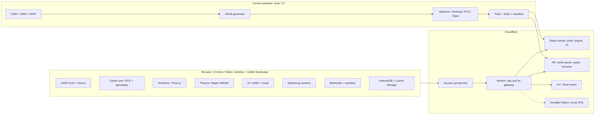

# GTA 5: Los Santos Web Edition — Product Requirements Document (PRD) & Technical Architecture

> **Version 2.0 — Full-Scope Edition** · supersedes v1.0 · last updated 2026-10-21
> *"GTA 5" / "Los Santos" is a working title.* Every GTA-flavoured name (characters, brands, districts, vehicles) lives in the content/strings layer, so it can be renamed without touching engine code (§2.4).

| Attribute | Specification |
| :--- | :--- |
| **Player / owner** | Ankit — single private player |
| **Primary run target** | Chrome on a **managed Chromebook**, opened from a Cloudflare Worker URL (nothing to install) |
| **Also supported** | Desktop Chrome / Edge / Firefox (Windows, macOS, Linux) · Android Chrome (landscape) · iOS Safari (landscape, PWA) |
| **Engine** | TypeScript · Three.js (WebGL2 baseline, WebGPU opt-in) · Rapier physics (WASM) · Astro shell |
| **Hosting** | Cloudflare Workers (Static Assets) + R2 (streamed world packs) + KV (cloud saves) · Cloudflare Access keeps the URL private |
| **Status** | Draft for implementation — build the vertical slice first (§7) |

**How to read this document:** §1 vision & scope · §2 asset & content policy · §3 platforms, tiers & input · §4 Feature Bible (every gameplay system, with IDs and priorities) · §5 technical architecture · §6 asset & world-generation pipelines · §7 milestones · §8 QA & Definition of Done · Appendices.

---

## 0. What Changed From v1

| # | Area | v1.0 | v2.0 |
| :-- | :-- | :-- | :-- |
| 1 | Scope | 7 pillars, 5 missions, 10 placeholder models | Full feature catalogue (§4) with IDs + priorities, campaign outline, heist framework, economy, AI, audio, cinematics, content-volume targets |
| 2 | Assets | Procedural `.glb` only | Layered strategy: procedural greybox (kept) → CC0/permissive kits → generated world from real-world open data (OSM / DEM / NAIP). Extracted Rockstar files are out of scope (§2) |
| 3 | Hosting | Workers Static Assets only, no D1/R2 | Two profiles — **A: static-only** (= v1, enough for the vertical slice) and **B: streaming** (adds R2 world packs + KV saves). Needed because free-plan Static Assets cap at 20,000 files per version and a city does not fit |
| 4 | Astro | `@astrojs/cloudflare` adapter | Adapter optional: Astro **static output** + a small custom Worker entry (`/api/*`, `/w/*`); no SSR needed |
| 5 | Devices | "Low-end laptops" | Tiers T0–T4, managed-Chromebook constraints, full mobile-landscape touch spec, accessibility |
| 6 | Engineering | DRS + instancing + pooling | Runtime architecture: threads, streaming, physics, AI, audio, saves, schemas, security, perf budgets, tests |
| 7 | Delivery | — | Milestones M0–M12, acceptance criteria, risk register |

**Nothing from v1 was dropped.** The 3 protagonists + abilities, sky-cam switch, districts, shops, 6 vehicle types + controls, 8-slot weapon wheel, 5-star wanted system, 5 missions, minimap/phone/radio UI, 10 model files, DRS, instancing and pooling are all carried forward in the matching sections.

### Architecture Decision Records (summary)

| ADR | Decision | Why |
| :-- | :-- | :-- |
| ADR-01 | Three.js, **WebGL2 baseline**; WebGPU as an opt-in path later | WebGL2 runs everywhere, incl. low-end Chromebooks and iOS. Chrome's WebGPU shipped on ChromeOS devices with Vulkan and on Android 12+ (Qualcomm/ARM GPUs), so it is not uniform |
| ADR-02 | Rapier (WASM) behind a `PhysicsBackend` interface; **inline first, worker later** | Simplest path to a playable game; move to a worker only if profiling says physics > 25 % of the frame |
| ADR-03 | World = **256 m cells grouped into ~1 km² super-packs**, streamed from R2 through a Worker gateway | Few large immutable files → few Worker invocations, trivial caching, no 20k-file limit |
| ADR-04 | **Data-driven content** (JSON + schema validation); the engine never hard-codes names or stats | Rename/retune without code changes; missions and heists authored as data |
| ADR-05 | **DOM** for HUD/menus, `<canvas>` for the minimap | Accessibility, fast iteration, crisp text on every DPR |
| ADR-06 | **bitECS** (struct-of-arrays) for high-count entities (traffic, peds, particles) | Cache-friendly, worker-friendly, low GC |
| ADR-07 | **Cloudflare Access** in front of the Worker | Keeps the link private to the owner; one-click on workers.dev |
| ADR-08 | **IndexedDB** saves + **KV cloud backup** + manual export | Managed devices can wipe site data; the cloud copy is P1, not optional |
| ADR-09 | Only **original / open-licensed / real-world-data** assets | See §2 |
| ADR-10 | Astro **static output** + custom Worker entry | Fewer moving parts than the SSR adapter; static-asset requests stay free and unlimited |

---

## 1. Vision, Goals & Scope

### 1.1 Vision
A private, browser-native, open-world crime-action sandbox in the spirit of Grand Theft Auto V: three playable protagonists, a living city streamed from the edge, deep driving / shooting / flying, heists, a 5-star wanted system, a phone, radio, economy and a full campaign — playable from a single Cloudflare Worker link on a locked-down Chromebook, scaling up to desktop and down to a phone held in landscape.

### 1.2 Product pillars
1. **Feel before fidelity** — driving, shooting and movement must feel great at 30 FPS on T0 before any visual polish.
2. **Streamed, not loaded** — one continuous world; no loading screens after boot except interior/heist transitions (< 2 s, masked).
3. **Data-driven** — missions, heists, vehicles, weapons, shops and strings are JSON; the engine is theme-agnostic.
4. **Runs on potato, shines on desktop** — five quality tiers with automatic selection and dynamic resolution scaling.
5. **One game, three input paradigms** — keyboard/mouse (+ Chromebook preset), gamepad, touch (landscape).
6. **Legally clean content** — every shipped asset has a row in the license ledger (§2.5).

### 1.3 Success metrics
| Metric | Target |
| :-- | :-- |
| Cold boot → interactive menu (20 Mbps) | ≤ 8 s |
| Cold boot → first playable frame | ≤ 30 s (first world packs included); warm start ≤ 6 s |
| Frame rate | T0 ≥ 30 FPS (p95 frame ≤ 40 ms) · T2+ 60 FPS (p95 ≤ 20 ms) · phones 30 FPS with DRS |
| Hitches | ≤ 1 frame > 100 ms per 5 minutes of play |
| JS heap | ≤ 350 MB (T0) · ≤ 700 MB (T4) |
| GPU memory (estimated) | ≤ 256 MB (T0) · ≤ 1.5 GB (T4) |
| Streaming | No visible pop-in inside 150 m at 100 km/h; far-LOD swaps hidden by fog/dither |
| Input latency | Touch/keyboard → visible response ≤ 100 ms |
| Save integrity | 0 corrupt saves in 1,000 automated save/load cycles |
| Stability | ≥ 99 % crash-free sessions; 60-minute soak without OOM on T1+ |

### 1.4 Non-goals
- Any extracted, ripped, leaked or reverse-engineered Rockstar / Take-Two data — models, textures, audio, radio music, map data, scripts, file formats, code (§2).
- Explicit sexual content (strip clubs, nudity). Violence is stylized.
- Public multiplayer at scale, matchmaking, microtransactions, ads.
- Console-level photorealism or ray tracing.
- Offline play of the whole world (only the cached area works offline).

### 1.5 Scope tiers & reality check
| Tier | Meaning | Contents |
| :-- | :-- | :-- |
| **P0** | Vertical slice — must be fun on its own | 3 × 3 km downtown slice, 1 protagonist (on foot + driving), 4 vehicles, 5 weapons, wanted 1–3★, 2 missions, HUD, save/load, Chromebook + touch builds |
| **P1** | Content-complete core | 3 protagonists + switching, 10 × 10 km core map, full wanted system, ~15 missions + 2 heists, shops, economy, phone, 4 radio stations, cloud save |
| **P2** | Full catalogue | Complete campaign (32 missions + 6 heists), strangers & freaks, activities, aircraft/boats, composite map incl. the Blaine-County analog, 8 stations, localization, interiors |
| **P3** | Stretch | Co-op lite, photo mode & replay, WebGPU path, mod packs, extra activities |

> **Reality check.** Console GTA V took years and hundreds of people. This PRD keeps GTA V's *feature scope* as the catalogue but delivers it at browser fidelity, in tiers, so the game is always playable and every milestone ends with something you can drive around in.

### 1.6 Content volume targets
| Content | P1 | P2 (full) |
| :-- | :-- | :-- |
| Playable area (bounding box) | 10 × 10 km core | ≈ 25 × 25 km composite (urban 1:1, rural compressed) |
| Story missions | 15 (+ 2 heists) | 32 (+ 6 heists) |
| Strangers & freaks chains | 4 | 16 |
| Random events | 6 | 18 |
| Activities | 6 | 25+ |
| Vehicles | 24 | 60+ |
| Weapons | 14 | 30+ |
| Pedestrian archetypes | 10 | 20 |
| Radio stations | 4 | 8 + "My Music" |
| Collectibles | 50 | 250 |
| Languages | en | en + hi |

---

## 2. Content & Asset Policy

### 2.1 The rule
Every asset the build ships must be one of:
1. **Procedural** — generated by our own code (v1 greybox `.glb` generators, synthesized audio, procedural textures).
2. **Open-licensed** (CC0 or equivalent) with a row in the license ledger.
3. **Attribution-licensed** (CC-BY, OFL fonts, ODbL map data) with attribution shown on the Credits screen.
4. **Self-made or AI-generated**, where the tool's terms allow this use (tool + terms recorded in the ledger).
5. **Real-world open data** — OpenStreetMap, elevation models, public-domain aerial imagery.

### 2.2 Real GTA V assets: not included
- Rockstar / Take-Two's models, textures, audio, radio music, map data and scripts are copyrighted. Extracting them and serving them from a Worker/R2 URL is copying and making them available. "Only I will play" does not change that: a deployed URL is reachable by anyone who has the link, and the files would sit on Cloudflare's infrastructure (account, terms-of-service and takedown risk). This PRD therefore contains **no extraction or conversion tooling** for them.
- There is also a hard practical blocker: the full game is on the order of 100 GB in proprietary formats. A browser tab — especially on a managed Chromebook — cannot hold or stream that.
- **What we do instead to get a "real" feel:** real streets and terrain from open map data (§6.3), high-quality CC0 kits, procedural generation and own-made art.

### 2.3 Keeping the link private
- Turn on **Cloudflare Access** for the Worker (dashboard → Workers & Pages → your Worker → *Access*, or Domains & Routes → *Enable Cloudflare Access* for workers.dev). The Zero Trust Free plan covers up to 50 users, so a one-person policy (your email + one-time PIN, or Google login) costs nothing.
- The Worker also validates the `Cf-Access-Jwt-Assertion` header (defence in depth, §5.15).
- Fallback if Access is unavailable: passphrase gate in the Worker (HttpOnly cookie, rate-limited).
- `robots.txt` disallow-all and `X-Robots-Tag: noindex, nofollow` on every response.

### 2.4 Naming layer
All display names (characters, brands, districts, vehicles, weapons, stations, missions) are keys in `content/strings/<lang>.json` and `content/defs/*.json`. A `theme` file maps IDs to display names. Ship two packs: the **working-title pack** (the GTA-flavoured names used in this PRD) and a **neutral pack** (original names). CI fails if a display string is hard-coded in TypeScript.

### 2.5 License ledger
`ASSETS_LICENSES.csv` — one row per asset or asset pack:

`id, path, source_url, author, license, license_url, attribution_required, modified, date_added, notes`

CI rules: (1) every file under `public/` and every R2 pack input maps to a ledger row; (2) licenses that are NC / ND / "editorial only" / unknown are rejected; (3) the Credits screen is generated from the ledger.

### 2.6 Approved sources (verify the license on each item at download time)
| Source | Typical license | Use for | Notes |
| :-- | :-- | :-- | :-- |
| Kenney | CC0 | City / road / car / character kits, UI, audio | Credit anyway |
| Quaternius | CC0 | Characters, animation sets, props, nature | Check each pack page |
| Poly Haven | CC0 | HDRIs, PBR textures, some models | |
| ambientCG | CC0 | PBR materials, decals | |
| Poly Pizza / OpenGameArt | Mixed | Props, vehicles, SFX, music | Record license per asset |
| Sketchfab | Per model | Hero props / vehicles | CC0 or CC-BY only; keep author URL |
| Freesound | Per file | SFX, ambience | CC0 / CC-BY only |
| Sonniss GDC bundles | Royalty-free licence | SFX libraries | Read the terms: use in a game OK, raw redistribution not |
| Incompetech / Free Music Archive | CC-BY etc. | Radio / library music | Attribution |
| Mixamo | Adobe terms | Humanoid animations | Embedding in a game is fine; do not redistribute raw packs; re-check terms when used |
| OpenStreetMap | ODbL | Roads, buildings, land use, water | Credit "© OpenStreetMap contributors" |
| USGS 3DEP / SRTM / Copernicus DEM | Public domain / open (attribution varies) | Terrain heights | Confirm per dataset |
| NAIP aerial imagery (USGS) | Public domain | Far-terrain colour | US only; downsample |
| Google Fonts | OFL | UI fonts | Self-host `woff2` |

---

## 3. Platforms, Device Tiers & Input

### 3.1 Target matrix
| Class | Typical devices | Browser | Priority | Notes |
| :-- | :-- | :-- | :-- | :-- |
| **Managed Chromebook (primary)** | Intel Celeron/Pentium, Core i3/i5 (UHD / Iris Xe), MediaTek Kompanio, Snapdragon 7c · 4–8 GB RAM | ChromeOS Chrome (stable) | P0 | Trackpad, no numpad, admin policies (§3.3) |
| Desktop | Windows / macOS / Linux, iGPU → dGPU | Chrome, Edge (primary) · Firefox · Safari 17+ | P0 | Mouse + keyboard, gamepad |
| Android landscape | Mid-range (Snapdragon 6/7, 4–6 GB) → flagship | Chrome ≥ 110 | P1 | Touch, thermal limits |
| iOS landscape | iPhone 12+, iPad | Safari 16.4+ (PWA from Home Screen) | P2 | Tight memory, no orientation lock, no vibration API |
| Tablets | iPad, Android tablets | as above | P2 | Larger touch targets |

### 3.2 Capability tiers
Auto-detected at first launch (§5.16), user-overridable in Settings → Graphics.

| Tier | Target hardware | Render scale (DRS) | FPS | Draw distance (buildings / props / terrain) | Shadows | Active traffic / peds | Physics Hz | Max texture | Post FX |
| :-- | :-- | :-- | :-- | :-- | :-- | :-- | :-- | :-- | :-- |
| **T0 Potato** | Celeron / MediaTek Chromebooks, old phones | 0.5–0.75 | 30 | 250 / 120 / 600 m | Blob shadows only | 8 / 12 | 30 | 512 | None |
| **T1 Low** | UHD 600-class iGPU, Snapdragon 6-series | 0.75–1.0 | 30–45 | 400 / 200 / 900 m | 1 cascade, 1024 | 14 / 24 | 45 | 1024 | FXAA |
| **T2 Medium** | Iris Xe, Snapdragon 8-series, M1 iPad | 1.0 | 60 | 600 / 300 / 1500 m | 2 cascades, 1024 | 25 / 45 | 60 | 1024–2048 | SMAA, light bloom |
| **T3 High** | Discrete laptop GPU, Apple M-series | 1.0–1.25 | 60 | 900 / 450 / 2500 m | 3 cascades, 2048 | 40 / 80 | 60 | 2048 | SMAA, bloom, SSAO-lite, colour grading |
| **T4 Ultra** | RTX 3060+, M2 Pro+ | 1.0–1.5 | 60–120 | 1400 / 700 / 4000 m | 4 cascades + contact shadows | 60 / 140 | 60 (+substeps) | 4096 | + volumetric fog, SSR-lite, DoF in photo mode |

Rules: phones never auto-select above T2 · downgrade is fast (≈ 3 s of sustained misses), upgrade is slow (≈ 60 s of headroom) with hysteresis · v1's DRS range (0.5 → min(DPR, 1.5)) is retained and extended in §5.16.

### 3.3 Managed-Chromebook constraints (primary target)
| Constraint | Impact | Design response |
| :-- | :-- | :-- |
| Nothing can be installed | Web-only | Run from the Worker URL; PWA install only if policy allows |
| Admin web filter / allow-lists | The URL may be blocked | Policy boundary — this PRD contains no filter-evasion; the fallback is a personal device or an allowed network |
| Site data may be cleared on sign-out / ephemeral sessions | IndexedDB saves can vanish | **Cloud save (KV) is P1**; manual export/import; `navigator.storage.persist()` status in Settings; banner when persistence is denied |
| DevTools may be disabled by policy | Cannot profile or read the console | In-game perf HUD, on-screen error console, error reporting to `/api/telemetry` |
| Low RAM / shared-memory iGPU | OOM, thermal throttling | T0 profile, DRS, small textures, LRU chunk cache, 30 FPS cap option |
| Keyboard: no numpad / Caps Lock; function row = media keys | Keys unusable | Letter/arrow keys only for gameplay; F-keys dev-only |
| Trackpad: right-click is a two-finger tap (or Alt+click); no held secondary button | Aim-hold is awkward | **Chromebook preset** (§3.5): aim = toggle, fire = click or `Enter`, optional keyboard-look |
| `Esc` releases pointer lock | Unexpected focus loss | `Esc` opens Pause; pointer lock is re-requested on resume; click-to-resume overlay |
| Autoplay policy | Silent audio | `AudioContext` created/resumed on first key/click ("Press any key") |

### 3.4 Mobile landscape specification
| Topic | Spec |
| :-- | :-- |
| Orientation | Manifest `"orientation": "landscape"`; `screen.orientation.lock("landscape")` after the fullscreen gesture (Android); iOS fallback: "Rotate your device" overlay in portrait |
| Fullscreen | Fullscreen API on first tap; iOS: Add to Home Screen (standalone) |
| Safe areas / viewport | `viewport-fit=cover`, `env(safe-area-inset-*)` padding on the HUD, `dvh`/`svh`, `overscroll-behavior: none` |
| Gesture hygiene | Disable pinch-zoom, double-tap zoom, long-press menu, pull-to-refresh, text selection; `touch-action: none` on canvas and controls |
| Multi-touch | Pointer Events with per-`pointerId` tracking; ≥ 5 simultaneous pointers |
| Hit targets | ≥ 48 CSS px (primary actions ≥ 64 px), ≥ 8 px gaps, thumb-reach layout, scalable and movable (layout editor) |
| Haptics | `navigator.vibrate` on Android (hits, crashes, explosions, wheel ticks); none on iOS; toggle in Settings |
| Gyro aim (P2) | DeviceOrientation / DeviceMotion; iOS needs a permission prompt |
| Wake lock | `navigator.wakeLock.request("screen")` during play |
| Memory | iOS: keep GPU ≈ 200–300 MB (T0/T1 only); handle `webglcontextlost` / `webglcontextrestored` |
| Thermal / battery | Frame-time drift → tier downgrade; "Battery saver" = 30 FPS cap; low-battery prompt |
| Data | Show download size before large fetches; "Wi-Fi only prefetch"; honour `navigator.connection.saveData` |
| Lifecycle | `visibilitychange` → pause, mute, snapshot save (Android may discard background tabs) |

### 3.5 Input system
Action-based abstraction: devices → **actions/axes** → gameplay. Rebinding, hold/toggle, dead-zones and sensitivity per device. Menus use spatial navigation (keyboard/gamepad) and pointer/touch.

**Default bindings**
| Context | Action | Keyboard + mouse | Gamepad (standard mapping) | Touch |
| :-- | :-- | :-- | :-- | :-- |
| Foot | Move | `W A S D` | Left stick | Floating left stick |
| Foot | Look / aim | Mouse (pointer lock) | Right stick | Right-half drag |
| Foot | Sprint | `Shift` (hold) | `L3` | Auto at full stick; sprint-lock button |
| Foot | Jump / vault / climb | `Space` | `A` | Jump button |
| Foot | Crouch / take cover | `C` | `RB` | Cover button |
| Foot | Aim (zoom) | Right mouse (hold) | `LT` | Aim button (hold or toggle) |
| Foot | Fire | Left mouse | `RT` | Large fire button (right thumb) |
| Foot | Reload | `R` | `X` | Reload button |
| Foot | Melee | `Z` | `B` | Melee button |
| Foot | Special ability | `B` | `L3 + R3` | Special button (appears when meter is full) |
| Foot | Weapon wheel | `Tab` (hold) | `LB` (hold) | Hold the weapon icon |
| Foot | Next / prev weapon | Mouse wheel · `[` `]` | D-pad ←/→ | Swipe on the weapon icon |
| Both | Interact / enter-exit vehicle | `F` or `Enter` | `Y` | Context button |
| Both | Camera (1st/3rd, chase cycle) | `V` | `R3` | Camera icon |
| Both | Phone | `P` | D-pad ↑ | Phone icon |
| Both | Character wheel | `Alt` (hold) | D-pad ↓ (hold) | Portrait widget, bottom-right |
| Both | Pause / map | `Esc` / `M` | `Start` / `Select` | `≡` / map icon |
| Vehicle | Accelerate | `W` / `↑` | `RT` | Right pedal (or auto-accelerate option) |
| Vehicle | Brake / reverse | `S` / `↓` | `LT` | Left pedal |
| Vehicle | Steer | `A D` / `← →` | Left stick | On-screen arrows, wheel or tilt |
| Vehicle | Handbrake | `Space` | `A` | Handbrake button |
| Vehicle | Horn / siren | `E` | `L3` | Horn button |
| Vehicle | Headlights | `H` | `LB` (tap) | Lights button |
| Vehicle | Radio wheel / next station | `R` (hold) / `.` | `LB` (hold) / D-pad →/← | Radio icon / swipe |
| Vehicle | Look behind | `Z` | `RB` (hold) | Look-behind button |
| Vehicle | Boost (supercars) | `Left Ctrl` | `B` | Boost button |
| Aircraft | Pitch / roll · yaw · throttle or collective | `W S A D` · `Q E` · `Shift / Ctrl` | Left stick · triggers/bumpers · `RT / LT` | Left stick · right stick · slider |
| Dev | Console / perf HUD | `` ` `` / menu toggle | — | Settings → Dev |

**Chromebook preset (overrides only)**
| Action | Binding |
| :-- | :-- |
| Aim | `Q` (toggle) — trackpad right-click is unreliable |
| Fire | Click / tap-to-click, or `Enter` |
| Look | Trackpad (pointer lock, `unadjustedMovement` when available) or `I J K L` |
| Character wheel | Hold `X` — `Alt` is ChromeOS's secondary-click modifier |
| Perf HUD | Settings → Dev, or console command `perf` — no F-keys |

### 3.6 Touch layouts (landscape)
```
ON FOOT
┌────────────────────────────────────────────────────────┐
│ ≡  [objective ........]        $12,450  ★★☆☆☆  [Gun]   │
│ ┌─────┐                                                │
│ │ map │   [Phone]                    [Aim]    [FIRE]   │
│ └─────┘                                                │
│ HP AR SP                      [Jump][Sprint][Cover]    │
│   ( stick )   [Switch]        [Reload][Use]            │
└────────────────────────────────────────────────────────┘
 Right half of the screen outside buttons = camera drag

DRIVING
┌────────────────────────────────────────────────────────┐
│ ≡  [objective ........]       $12,450  ★★☆☆☆  120 km/h │
│ ┌─────┐                                                │
│ │ map │  [Radio]  [Lights]  [Horn]        [Cam]  [Exit]│
│ └─────┘                                                │
│ [◀][▶] steering (or tilt)                 [Brake][GAS] │
│ [Handbrake]                                [Drive-by]  │
└────────────────────────────────────────────────────────┘

AIRCRAFT: left stick = pitch/roll · right stick = yaw + collective/throttle · [Gear] [Cam] [Exit]
```
Rules: dynamic (floating) stick anchors where the thumb lands · every control has size/opacity/position sliders and a drag-to-arrange layout editor · "one-handed" preset · contextual buttons (Interact, Boost, Special, Exit) appear only when usable · auto-sprint when the stick is pushed past 90 %.

### 3.7 Accessibility
- Remap everything; hold/toggle for aim, sprint, crouch; adjustable double-tap and hold timings.
- Aim assist 0–100 %; driving assists (steering assist, auto-brake, drive-to-waypoint "taxi mode", P2); one-handed touch preset.
- Subtitles on by default: size S–XL, background opacity, speaker colours.
- Colour-blind modes (protan / deutan / tritan) via LUT + alternate HUD palette; high-contrast minimap; UI scale 75–150 %.
- Reduce motion: no camera shake / motion blur, shorter sky-cam; photosensitivity guard (no flashes > 3 Hz, dimmable lightning/explosion flash).
- Audio: separate sliders per bus, mono downmix, visual directional indicators for off-screen threats.
- Menus are semantic DOM with ARIA roles and full keyboard/gamepad navigation.

### 3.8 Localization
All strings keyed (ICU MessageFormat via a small library); `Intl` for numbers, currency and dates; English at P1, Hindi at P2 (Devanagari subset font lazy-loaded). Subtitles, phone texts and radio banter are all string-table driven.

---

## 4. Feature Bible

Legend: **ID** = traceable requirement · **Pri** = P0–P3 (§1.5) · numbers are *starting tuning values* to be playtested · names are working titles (§2.4).

### 4.1 Core loop
| Loop | What the player does |
| :-- | :-- |
| 30 seconds | Move, drive, shoot, steal, evade — the sandbox verbs |
| 5 minutes | Take a job (mission / activity / random event) → payout → spend |
| 30 minutes | Story mission → heist prep → heist → unlock area / vehicle / property |
| Campaign | 3 acts → finale → free-roam 100 % completion |

### 4.2 Protagonists & switching
| ID | Feature | Spec | Pri |
| :-- | :-- | :-- | :-- |
| PLR-01 | Michael De Santa | Retired bank robber, Rockford Hills. **Bullet Time**: world time ×0.4 (60 % slower), +50 % accuracy, +25 % damage while active | P1 |
| PLR-02 | Franklin Clinton | Street hustler / driver, Strawberry & Vinewood. **Driving Slow-Motion**: world ×0.5 while driving, sharper steering, drift stabilisation | P1 |
| PLR-03 | Trevor Philips | Career criminal, Sandy Shores. **Red Mist**: ×2.5 combat & explosive damage, takes only 35 % incoming damage | P1 |
| PLR-04 | Special meter | 0–100. Base duration: Michael 10 s · Franklin 12 s · Trevor 15 s, scaled by the *Special* skill (up to ×2). Refill: Michael headshots +15 · Franklin drifts / near-misses +3 each · Trevor damage dealt +1 per 10 dmg. No passive regen | P1 |
| PLR-05 | Sky-cam switch | Three stages: zoom-out through clouds (1.2 s) → pan across San Andreas to the target's live location (0.8–2.5 s, distance-scaled) → zoom-in (1.2 s) with character colour grade. The target area is **pre-streamed during the pan**; switching is blocked while a mission locks it | P1 |
| PLR-06 | Switch wheel | Portraits Michael (blue) · Franklin (green) · Trevor (orange) with live stat bars: Stamina, Shooting, Strength, Stealth, Flying, Driving, Capacity, Special | P1 |
| PLR-07 | Off-screen life | Inactive characters follow a daily schedule; on switch-in they appear mid-scene from a pool of ≥ 12 scenes per character, chosen by time of day | P2 |
| PLR-08 | Per-character state | Cash, outfit, weapons, vehicles, safehouse, skills, contacts and wanted level are separate; world state (time, weather, properties) is shared | P1 |
| PLR-09 | Outfits | Per-character wardrobe (≥ 10 outfits at P2), clothing stores; changing outfit clears the "recognised" flag (§4.7) | P2 |
| PLR-10 | Health model | Health 200 (auto-regen to 50 %, v1), armor 100, death → hospital respawn with bill | P0 |

### 4.3 World, districts & landmarks
| ID | Feature | Spec | Pri |
| :-- | :-- | :-- | :-- |
| WLD-01 | Streamed open world | One continuous world, no loading screens (§5.6) | P0 |
| WLD-02 | Floating origin + 256 m cell grid | Rebase when the camera is > 2 km from origin (§5.5) | P0 |
| WLD-03 | Road network | Freeways, avenues, side streets, alleys, parking lots, bridges, tunnels, interchanges | P0 |
| WLD-04 | Terrain | Beaches, hills, canyons, desert, mountains from elevation data | P1 |
| WLD-05 | Water | Ocean, lakes, rivers / flood channels, pools; swimming and underwater | P1 |
| WLD-06 | Buildings | 9 facade archetypes + hero landmarks; most non-enterable | P1 |
| WLD-07 | Interiors | Small cells entered through a ≤ 1 s fade: shops, Customs, safehouses, bank, jewelry store, hospital, police station | P1 |
| WLD-08 | Street props | Lights, signs, hydrants, benches, bins, billboards (fictional brands) | P0 |
| WLD-09 | Vegetation | Palms, trees, shrubs, grass cards (T2+), wind sway | P1 |
| WLD-10 | Night life | Street lights, neon, lit windows, headlight pools | P1 |
| WLD-11 | Map borders | Ocean / mountain walls and terrain design instead of invisible walls; "turn back" prompt | P0 |
| WLD-12 | Restricted zones | Military base, airport ramp → instant wanted escalation | P1 |
| WLD-13 | Interactive props | Breakable glass, fences, bins, lamp posts, hydrant jets | P1 |
| WLD-14 | Rail / metro | Spline-driven trains with crossing gates | P2 |
| WLD-15 | Fast travel | Taxi / cutscene transition (masks streaming) | P2 |

**Zone catalogue** (Z01–Z16 come from one contiguous real-world region; Z17–Z24 from separate regions placed by the compositor, §6.3)

| Zone | Working name | Real-world analog (data source) | Character | Landmarks & content |
| :-- | :-- | :-- | :-- | :-- |
| Z01 | Downtown Los Santos | Downtown LA / Bunker Hill | Glass towers, avenues, freeway stacks | Maze Bank Tower crown, FIB Building, IAA Tower (v1), Union Depository, police HQ, Medical Center |
| Z02 | Rockford Hills | Beverly Hills | Mansions, palm boulevards, boutiques | Michael's mansion, jewelry store (heist), golf club |
| Z03 | Vinewood Hills | Hollywood Hills / Griffith Park | Winding roads, hillside villas | **VINEWOOD sign** (v1), observatory, amphitheatre, trails, reservoir |
| Z04 | Vinewood Boulevard | Hollywood / West Hollywood | Neon, theatres, clubs, studios | Studio lot, walk of stars, paparazzi events |
| Z05 | Vespucci Beach & Canals | Venice Beach & Canals | Boardwalk, skate park, muscle beach | Street performers, canal bridges, surfers |
| Z06 | Del Perro Pier | Santa Monica Pier | Pier, illuminated **Ferris wheel** (v1), coaster | Arcade, fishing, pier shootout |
| Z07 | Little Seoul | Koreatown | Dense mid-rise, neon signage | Nightlife, karaoke, food stalls |
| Z08 | Mirror Park | Silver Lake / Echo Park | Lake, hills, cafés | Park activities, joggers, concerts |
| Z09 | South Central (Davis, Strawberry, Rancho) | South LA / Compton | Low-rise residential | Franklin's house, dealership (mission 1), gang turf |
| Z10 | Industrial East (Cypress Flats, La Mesa) | Vernon / Commerce / LA River | Factories, rail yards, junkyards | Storm-channel chase set pieces, warehouses |
| Z11 | Port of Los Santos | Port of Los Angeles | Container cranes, ships, drydocks | Stealth routes, cargo heist |
| Z12 | LSIA | LAX | Runways, terminals, cargo | Airliners, restricted ramp, flight school (P2) |
| Z13 | Chumash Coast | Malibu / PCH | Cliff highway, beach houses, tunnels | Coastal drives, rock climbing |
| Z14 | Tongva Canyon | Topanga Canyon | Woodland, hairpins | Hunting, off-road, hideouts |
| Z15 | Stadium & Racetrack | Dodger Stadium / LA Coliseum | Stadium events, track | Races, concerts (P2) |
| Z16 | Freeways & River | LA freeway network & LA River channel | Multi-level interchanges, concrete channel | High-speed chases, tunnels |
| Z17 | Sandy Shores | Salton Sea (Bombay Beach, Salton City) | Desert town, trailers | **Trevor's airfield** (v1), industrial yard |
| Z18 | Alamo Sea | Salton Sea | Inland sea, salt flats, derelict boats | Boats, planes, fishing |
| Z19 | Grapeseed & Farmland | Central Valley | Farms, silos | Crop-duster, tractor, rural roads |
| Z20 | Paleto Bay | Central coast town | Small harbour town, sawmill | Small bank job, bay |
| Z21 | Mount Chiliad | San Gabriel Mountains | Alpine trails, summit | Off-road, skydive spot, cable car (P3) |
| Z22 | Fort Zancudo | Edwards AFB / March ARB | Military base | Restricted airspace, jets, tanks (P3) |
| Z23 | Wind Farm & Desert Highway | San Gorgonio Pass | Turbines, desert roads | Road trips, stunt jumps |
| Z24 | Pacific & Islands | Channel Islands / Catalina | Open sea, reefs, wrecks, yachts | Diving, sharks, treasure, boats |
| Z25 | Underground | Metro / storm drains / tunnels | Tunnels, stations | Chase tunnels (v1 heist escape), metro (P2) |

### 4.4 On-foot movement & combat
| ID | Feature | Spec | Pri |
| :-- | :-- | :-- | :-- |
| MOV-01 | Locomotion | Walk / jog / sprint; stamina bar tied to the *Stamina* skill | P0 |
| MOV-02 | Jump, vault, climb | Vault ≤ 1.2 m, climb ledge ≤ 2.5 m with auto-grab, step-up 0.35 m, slopes ≤ 45° | P1 |
| MOV-03 | Stealth movement | Crouch walk; noise radius: sprint 20 m · walk 8 m · crouch 3 m | P1 |
| MOV-04 | Swim / dive | Tread, swim, dive; breath 30 s → 120 s by *Lung capacity*; drowning damage | P1 |
| MOV-05 | Ragdoll | Collisions, explosions, falls (> 6 m hurts) with get-up | P1 |
| MOV-06 | Parachute / skydive | Deploy ≥ 40 m; freefall steering; base jumps | P2 |
| MOV-07 | Contextual interaction | Hold-to-use prompts: doors, shops, pickups, vehicles | P0 |
| MOV-08 | Cameras | Third-person over-the-shoulder (collision-aware, shoulder swap), first-person (`V`), aim zoom, vehicle chase / hood / cinematic, three FOV presets | P0 |
| CMB-01 | Weapon wheel | 8 slots (v1): Fists · Combat Pistol · Micro SMG · Carbine Rifle · Pump Shotgun · Heavy Sniper · RPG · Sticky Bombs/Grenades — extended by category in §4.5 | P0 |
| CMB-02 | Aim modes | Free-aim, assisted (soft lock + adhesion), first-person; assist 0–100 % | P0 |
| CMB-03 | Cover | Snap-to-cover (`C`), blind-fire, peek, cover-to-cover, low-cover vault | P1 |
| CMB-04 | Ballistics | Hitscan ≤ 120 m; projectiles for snipers / heavy weapons with travel time; bullet drop for snipers only; thin-material penetration (glass, wood, car doors) with falloff | P1 |
| CMB-05 | Damage zones | Head ×3, torso ×1, limbs ×0.7; armor absorbs 70 % of damage until depleted | P0 |
| CMB-06 | Spread & recoil | Bloom while moving/firing; ADS tightens; per-weapon recoil curve; *Shooting* skill cuts sway/recoil by up to 30 % | P0 |
| CMB-07 | Melee | 3-hit fist combo, weapon swings, rear takedown (silent), knockdown | P1 |
| CMB-08 | Throwables | Arc preview, cook time, bounce, sticky attach to vehicles/peds, remote detonation | P1 |
| CMB-09 | Explosions | Radius damage + impulse + fire; vehicle **chain reactions** (v1); fuel-tank leak → explode | P0 |
| CMB-10 | Fire | Spreads over grass, fuel, vehicles; 10 dps burn; water/extinguisher/fire trucks | P2 |
| CMB-11 | Drive-by | One-handed weapons and SMGs for drivers; any weapon for passengers | P1 |
| CMB-12 | Hit feedback | Hit markers, damage-direction ring, flinch, screen flash, haptics | P0 |
| CMB-13 | Healing | Auto-regen to 50 % (v1); medkits, armor from Ammu-Nation or pickups | P0 |
| CMB-14 | Death & arrest | **Wasted** → hospital respawn, bill = min(10 % cash, $5,000). **Busted** → police station, fine = min(5 % cash, $2,500). Hardcore mode (P2) also removes weapons | P0 |
| CMB-15 | Difficulty | Story / Normal / Hard modify enemy accuracy, aggression, health and wanted decay | P1 |
| CMB-16 | Stylized violence | No gore or dismemberment; cartoon-grade impact FX | P0 |

### 4.5 Weapons catalogue
Defaults to tune; damage vs. player 200 HP / ped 100 HP / police 150 HP / SWAT 200 HP + 100 armor.

| Class | Weapon (working name) | Dmg | RoF (rpm) | Mag / reserve | Effective range (m) | Notes | Pri |
| :-- | :-- | :-- | :-- | :-- | :-- | :-- | :-- |
| Melee | Fists | 8 | 120 | — | 1.5 | 3-hit combo | P0 |
| Melee | Knife | 35 | 100 | — | 1.8 | Silent, takedowns | P1 |
| Melee | Baseball Bat | 40 | 70 | — | 2.0 | Knockdown | P1 |
| Melee | Crowbar / Golf Club | 38 / 30 | 80 | — | 2.0 | Props can break | P2 |
| Handgun | Combat Pistol (v1) | 26 | 300 | 12 / 120 | 50 | Suppressor, extended mag | P0 |
| Handgun | Heavy Revolver | 80 | 90 | 6 / 36 | 55 | High recoil | P1 |
| Handgun | Stun Gun | stun 3 s | 40 | 1 / recharge | 8 | Non-lethal | P2 |
| SMG | Micro SMG (v1) | 14 | 900 | 16 / 160 | 25 | Drive-by king | P0 |
| SMG | SMG | 20 | 700 | 30 / 300 | 35 | | P1 |
| SMG | Machine Pistol | 12 | 1000 | 20 / 200 | 20 | | P2 |
| Shotgun | Pump Shotgun (v1) | 8 × 12 pellets | 70 | 8 / 40 | 20 | Spread 6° | P0 |
| Shotgun | Sawed-Off | 8 × 10 | 110 | 2 / 24 | 10 | Wide spread | P2 |
| Shotgun | Auto Shotgun | 6 × 10 | 200 | 8 / 48 | 18 | | P2 |
| Rifle | Carbine Rifle (v1) | 30 | 750 | 30 / 300 | 80 | Scope, grip, suppressor | P0 |
| Rifle | Assault Rifle | 34 | 600 | 30 / 300 | 85 | | P1 |
| Rifle | Marksman Rifle | 55 | 300 | 10 / 100 | 140 | Semi-auto | P2 |
| LMG | Combat MG | 28 | 900 | 100 / 500 | 75 | Slows movement | P2 |
| Sniper | Sniper Rifle | 100 | 60 | 10 / 50 | 300 | Scope | P1 |
| Sniper | Heavy Sniper (v1) | 220 | 40 | 5 / 25 | 400 | One-shot unarmored; light-cover penetration | P0 |
| Heavy | RPG (v1) | 1000, radius 7 m | 6 | 1 / 10 | 250 | Vehicle chain reactions | P0 |
| Heavy | Grenade Launcher | 250, radius 5 m | 40 | 10 / 30 | 120 | | P2 |
| Heavy | Minigun | 20 | 6000 | 500 / 1500 | 70 | Spin-up, slow | P3 |
| Heavy | Homing Launcher | 800 | 6 | 1 / 10 | 400 | Locks aircraft | P3 |
| Thrown | Grenade | 300, radius 6 m | — | 3 s fuse | 30 | | P0 |
| Thrown | Sticky Bomb (v1) | 600, radius 6 m | — | remote / timed | 30 | Sticks to vehicles | P0 |
| Thrown | Molotov | 40 + fire pool (r 3 m) | — | — | 25 | 10 dps burn | P2 |
| Thrown | Tear Gas | status | — | — | 25 | AI flees / coughs | P3 |
| Misc | Flare Gun · Fire Extinguisher · Jerry Can · Parachute | — | — | — | — | Utility | P2 |

Attachments (P2): suppressor, flashlight, extended mag, scope (red-dot / 4× / sniper), grip, muzzle brake; cosmetic tints. Ammo types (P3): FMJ, armor-piercing, incendiary, explosive (cheat only).

### 4.6 Vehicles, aircraft & boats
| ID | Feature | Spec | Pri |
| :-- | :-- | :-- | :-- |
| VEH-01 | Enter / exit / hijack | `F`/`Enter`; carjack animations, pull out the driver, steal parked, lock-pick | P0 |
| VEH-02 | Handling model | Raycast vehicle: per-class parameters (below) | P0 |
| VEH-03 | Surface grip | Asphalt 1.0 · concrete 0.95 · wet asphalt 0.75 · dirt 0.70 · gravel 0.60 · grass 0.55 · mud 0.45 · sand 0.50 · snow/ice 0.35 (P3) | P0 |
| VEH-04 | Drift & assists | `Space` handbrake drift (v1); counter-steer assist scales with *Driving* | P0 |
| VEH-05 | Boost | Limited-charge boost on sports / super (v1 nitro): 3 s per charge, 20 s recharge | P1 |
| VEH-06 | Damage | Body / engine / tank 1000 each; 4-stage deformation morphs + detachable doors, hood, trunk, bumpers; tire bursts; shatter windows; smoke < 300 → fire < 150 → explode 5 s after fire at 0 | P1 |
| VEH-07 | Lights & sirens | Headlights (`H`, v1), brake, indicators, interior; police lightbar + siren (`E`, v1) | P0 |
| VEH-08 | Horn | `E` (v1); NPCs react | P0 |
| VEH-09 | Radio | In-vehicle station wheel (§4.15) | P1 |
| VEH-10 | Customization | At **Los Santos Customs** (v1): respray, wheels, body kits, engine / brakes / transmission / suspension / turbo / armor, neon underglow (v1), tint, plates | P1 |
| VEH-11 | Garages & insurance | Store vehicles in property garages; destroyed personal vehicles recoverable for a fee | P1 |
| VEH-12 | Traffic law | Police react to reckless driving they witness (§4.7) | P1 |
| VEH-13 | Parked-car spawns | District-profile rarity tables (supercars rare outside rich zones) | P0 |
| VEH-14 | Trailers & tow | Articulated joints, tow truck | P2 |
| AIR-01 | Helicopter | Assisted default (hover hold, auto-level) + advanced mode; rotor damage; **Buzzard** attack chopper (v1) | P1 |
| AIR-02 | Planes | Simple lift/drag + stall, assisted mode, gear/flaps, runways | P2 |
| AIR-03 | Boats & jet skis | 4–8 buoyancy sample points, propeller thrust, planing, wake FX, beaching | P2 |
| AIR-04 | Trains | Spline-driven AI trains, boardable (P3) | P2 |
| AIR-05 | Bicycles | Stamina-based, tricks | P2 |
| AIR-06 | Restricted airspace | Fort + airport rules, jets scramble (P3) | P1 |

**Vehicle classes**
| Class | Count P1 / P2 | Archetype | Top speed (km/h) | Notes |
| :-- | :-- | :-- | :-- | :-- |
| Compact | 2 / 4 | FWD, light, understeer | 150–170 | |
| Sedan / taxi | 2 / 5 | Soft suspension | 180–210 | |
| Coupe | 1 / 3 | RWD | 200–230 | |
| Muscle (**Sabre Turbo / Gauntlet**, v1) | 2 / 5 | RWD, heavy, oversteer, torque | 210–250 | Burnouts, rear drift |
| Sports (**Infernus**, v1) | 2 / 6 | AWD/RWD, high grip | 260–290 | Boost |
| Super (**Zentorno**, v1) | 2 / 5 | AWD, downforce | 300–330 | Boost |
| SUV / off-road (**Granger**, v1) | 2 / 5 | AWD, long suspension, high CoG | 170–200 | Heavy durability, off-road traction |
| Pickup / van / truck | 2 / 5 | RWD, heavy | 140–180 | Tow truck, delivery van |
| Heavy (bus, garbage, semi) | 1 / 4 | Slow, wide turn | 100–130 | Trailers at P2 |
| Emergency (**LSPD cruiser**, v1; SWAT SUV; ambulance; fire truck; police bike) | 3 / 6 | Scripted lights / sirens | — | AI ramming |
| Motorcycle (**PCJ-600**, v1) | 2 / 5 | Lean model, wheelie / stoppie | 200–280 | Weaves traffic |
| ATV / buggy | 1 / 3 | Off-road | 120–160 | |
| Boat / jet ski | 1 / 4 | Buoyancy | 80–140 | |
| Helicopter (**Buzzard**, v1) | 1 / 4 | Assisted flight | 250 | News, light, cargo (P3) |
| Plane | 0 / 4 | Lift model | 250–500 | Prop, stunt, jet (P3) |
| Train / metro | 0 / 2 | Spline | 120 | |

**Handling parameters** (`VehicleDef.handling`): mass, centre-of-mass offset, wheelbase, track, suspension {travel, stiffness, damping, anti-roll}, tire {peak slip, longitudinal grip, lateral grip, rolling resistance}, drivetrain {FWD/RWD/AWD, torque curve, gear ratios, final drive, shift time}, brake {force, front/rear bias}, steering {max angle, speed reduction, assist}, aero {drag, downforce}, handbrake grip multiplier, drift assist. Full JSON schema in §5.13.

### 4.7 Wanted level & police
| ID | Feature | Spec | Pri |
| :-- | :-- | :-- | :-- |
| WNT-01 | Heat model | Crimes add **heat** only when witnessed (cop line-of-sight, FOV 120°, or a civilian who completes a 3–6 s call-in; killing the witness or breaking the phone cancels it) | P0 |
| WNT-02 | Star thresholds | 1★ ≥ 20 · 2★ ≥ 60 · 3★ ≥ 140 · 4★ ≥ 300 · 5★ ≥ 600 | P0 |
| WNT-03 | Search state machine | Seen → **Pursuit** (cops know your position) → **Lost** (search around last-known; stars blink) → **Cleared** when the evade timer expires | P0 |
| WNT-04 | Evade rules | Unseen **and** outside the search radius for the star's timer; hiding in tunnels, alleys, garages; respray at Customs (v1) resets vehicle recognition; outfit change resets pedestrian recognition | P0 |
| WNT-05 | Dispatch | Out-of-view spawns behind the view cone ≥ 60 m away, on roads, with a repetition filter | P0 |
| WNT-06 | Tactics | PIT / ramming, box-in, roadblocks, spike strips, foot cops using cover, flashlights at night, helicopter spotlight cone | P1 |
| WNT-07 | Police radio | Procedural dispatch chatter driven by event data | P2 |
| WNT-08 | Special cases | Restricted airspace → 4★ in 10 s · restricted base → warning (5 s) then 5★ | P1 |

| Stars | Search radius | Evade timer | Response |
| :-- | :-- | :-- | :-- |
| ★☆☆☆☆ | 80 m | 15 s | 1–2 patrol cruisers investigate; non-lethal at first, escalates if you resist |
| ★★☆☆☆ | 110 m | 25 s | 3–5 cruisers + bikes open fire, ram, block roads |
| ★★★☆☆ | 150 m | 40 s | Police **helicopter** with spotlight tracking, roadblocks, aggressive intercepts |
| ★★★★☆ | 200 m | 55 s | **NOOSE / SWAT** armored SUVs, rappelling teams, heavy rifles |
| ★★★★★ | 260 m | 75 s | Full lockdown: continuous spawns, armored units, two helicopters, rooftop snipers (P2) |

| Crime | Heat | Notes |
| :-- | :-- | :-- |
| Assault pedestrian | +8 | |
| Shoot a weapon in public | +6 | Per 5 s of firing |
| Steal an occupied vehicle (carjack) | +10 | Parked theft +6 if seen |
| Hit-and-run | +15 | |
| Kill a pedestrian | +20 | |
| Run a red light in view of police | +2 | Stacks to 1★ after 5 infractions |
| Assault a cop | +40 | |
| Destroy a police vehicle | +60 | |
| Explosion near the public | +25 | |
| Kill a cop | +150 | Immediate 3★ |
| Heist alarm tripped | +100 | |

**Busted** (≤ 2★, cop adjacent, player not shooting) → hands-up prompt → police station + fine. **Wasted** → hospital + bill (CMB-14).

### 4.8 AI: pedestrians, traffic, combat, wildlife
| ID | Feature | Spec | Pri |
| :-- | :-- | :-- | :-- |
| AIP-01 | Archetypes | 20 at P2 (10 at P1): business, tourist, jogger, beach-goer, skater, cyclist, hipster, gang member, delivery, construction, vendor, security, paramedic, firefighter, elderly, student, dog-walker, homeless, driver, cop | P1 |
| AIP-02 | Sidewalk behaviour | Walk sidewalks, cross at crosswalks on signal, queue, sit, talk, use phone, jog, sunbathe | P1 |
| AIP-03 | Reactions | Flee, cower, fight back (some), film with phone, call police; panic spreads by proximity | P1 |
| AIP-04 | Ambient scenarios | Musician, hot-dog stand queue, couple on bench, photographer — time-of-day gated | P2 |
| AIP-05 | Weather response | Umbrellas, shelter, fewer joggers | P2 |
| AIP-06 | Crowd steering | Spatial-hash separation + simple avoidance (ORCA-lite) | P1 |
| AIT-01 | Lane graph | Directional lanes from road data; intersections with signal phases | P0 |
| AIT-02 | Driving behaviour | Follow, stop at lights, overtake (P2), react to collisions, honk, flee gunfire | P1 |
| AIT-03 | Emergency response | Cars yield to sirens; ambulances/fire trucks respond to incidents | P1 |
| AIT-04 | Statistical traffic | Beyond 120 m, vehicles move kinematically along lane splines (no physics) | P0 |
| AIT-05 | Parked cars | Static props with openable doors, can be stolen | P0 |
| AIC-01 | Perception | Vision cone + hearing events (gunshots, explosions, horns) | P0 |
| AIC-02 | States | Idle → alert → combat → flee | P0 |
| AIC-03 | Tactics | Cover scoring, flank, suppress, grenade throw, squad roles | P1 |
| AIC-04 | Gangs | 3 territories; hostile spawns on entry; rival-gang missions | P2 |
| AIW-01 | Wildlife | Birds (flocks), seagulls, fish schools, sharks, deer, coyote, cougar, boar, dogs/cats; hunting | P2 |

**AI level-of-detail rings:** ring 0 < 40 m (full animation + physics) · ring 1 40–120 m (simplified, half-rate animation) · ring 2 120–300 m (path-position only, impostors) · ring 3 > 300 m (pooled / despawned). Budgets per tier are in §3.2.

---

### 4.9 Missions & campaign
| ID | Feature | Spec | Pri |
| :-- | :-- | :-- | :-- |
| MIS-01 | Mission runtime | Data-driven node graph (§5.13): sequence / parallel / branch nodes, triggers, fail conditions, checkpoints | P0 |
| MIS-02 | Checkpoints & retry | Auto-checkpoint after each objective block; retry from checkpoint or restart; skip after 3 fails (P2) | P0 |
| MIS-03 | Mission HUD | Objective line, timer, enemy blips, distance meter, "help" prompts | P0 |
| MIS-04 | Medals | Gold-medal side objectives per mission (accuracy, time, no-damage, headshots) | P2 |
| MIS-05 | Replay | Replay any completed mission from the phone's *Missions & Heists* app (v1) | P1 |
| MIS-06 | Switching in missions | Multi-hero missions allow free switching; the sky-cam resolves to the active objective area | P1 |
| MIS-07 | Dialogue & drive-and-talk | Subtitled banter during driving and walking, interruptible, resumable | P1 |
| MIS-08 | Mission locks | While active: restricted switching, no save, scripted wanted floor, scripted weather/time if needed | P0 |

**Mission archetypes** (each is a reusable template): Chase · Tail · Shootout · Stealth infiltration · Escort / defend · Race · Flight / heli · Boat · Assassination (silenced / sniper) · Multi-phase heist · Rescue / extraction · Delivery / smuggle · Boss fight (armored) · Drive-and-talk · Surveillance · Parachute insertion · Underwater salvage · Vehicle theft list · Evade · Sabotage.

**Campaign outline** — original story. Premise (working): the **Meridian Group**, a real-estate-and-security conglomerate that owns half the city council, is buying up Los Santos block by block. Three criminals with tangled debts — a retired crew boss, a repo driver who wants out, and a desert smuggler whose airfield Meridian wants — are drawn into escalating jobs that end with robbing Meridian's gold under the Union Depository. (v1 seed missions are marked **v1**.)

| # | Act | Mission (working title) | Hero | Archetype | Introduces / unlocks | Pri |
| :-- | :-- | :-- | :-- | :-- | :-- | :-- |
| 01 | I Debts | **Repossession** (v1) — locate the high-end sports coupe in Rockford Hills, deliver it to the dealership while evading pursuit | Franklin | Chase / delivery | Vehicle theft, 1★ wanted; unlocks Customs, garage | P0 |
| 02 | I | Corner Store Math | Franklin | Shootout | Cover, weapon wheel; unlocks Ammu-Nation | P0 |
| 03 | I | **Father/Son & Debt Recovery** (v1) — intercept the fleeing yacht/convoy on the boulevard, eliminate the cartel guards | Michael | Chase + shootout | Bullet Time; mansion, contacts | P1 |
| 04 | I | Dust Devil | Trevor | Escort / shootout | Red Mist; Sandy Shores; trailer safehouse | P1 |
| 05 | I | **Trevor's Airfield Arms Run** (v1) — clear rival gang forces in Sandy Shores, secure the Buzzard at the airfield | Trevor | Flight + shootout | Helicopter, parachute; unlocks Buzzard | P1 |
| 06 | I | Quiet Hours | Michael | Stealth / tail | Stealth, suppressors, tailing | P1 |
| 07 | I | Wheelman | Franklin | Street race | Driving slow-mo; race UI; vehicle upgrades | P1 |
| 08 | I | Three Bad Ideas | All | Switch mission | Mid-mission character switching; crew contacts | P1 |
| 09 | I | Casing the Joint | Michael + Franklin | Surveillance | Heist planning board | P1 |
| 10 | I | **The Vangelico Jewelry Store Heist** (v1) — case the downtown perimeter, neutralize security, grab the **$250,000** diamond take, escape the 3★ response through Los Santos tunnels/boulevards | All | **Heist 1** | Smart vs loud approach, loot grab | P1 |
| 11 | I | Heat Wave | Franklin | Evade (4★ lite) | Evasion tutorial, hideouts | P1 |
| 12 | II Leverage | Meridian Handshake | Michael | Drive-and-talk | Antagonist intro | P1 |
| 13 | II | Flatbed | Trevor | Delivery / chase | Tow truck, heavy vehicles | P1 |
| 14 | II | Harbor Lights | Franklin | Boat + shootout | Boats, Port | P1 |
| 15 | II | Long Drop | Trevor + Michael | Parachute insertion | Skydiving | P1 |
| 16 | II | Steel Cage | Franklin | Boss fight | Armored enemies | P1 |
| 17 | II | The Armored Run | All | **Heist 2** (convoy) — **$400,000** | Intercept, spike strips | P1 |
| 18 | II | Blue Wall | Michael | Escape | 5★ mechanics | P2 |
| 19 | II | Sundown at Alamo | Trevor | Boat / air | Alamo Sea, planes | P2 |
| 20 | II | Switchback | Franklin + Michael | Off-road chase | Off-road handling | P2 |
| 21 | II | Inside Man | Michael | Stealth infiltration | Hacking mini-game, disguises | P2 |
| 22 | II | Container Blues | Franklin + Trevor | Stealth | Cranes, forklifts | P2 |
| 23 | II | The Port Container Job | All | **Heist 3** — **$600,000** | Decoy / crane swap | P2 |
| 24 | II | Ashes | Trevor | Defend / rescue | Protect NPCs | P2 |
| 25 | II | Paper Trail | Michael | Drive-and-talk + shootout | Intel items | P2 |
| 26 | II | Rooftop Rules | Franklin | Overwatch / sniper | Sniping, overwatch | P2 |
| 27 | II | Night Shift | Trevor + Franklin | Sabotage | Power-grid blackout at night | P2 |
| 28 | III Union | Data Vault | All | **Heist 4** (tower) — **$750,000** | Rappel, hacking | P2 |
| 29 | III | Cargo Hold | Franklin + Trevor | Plane hijack | Planes | P2 |
| 30 | III | Airport Cargo Job | All | **Heist 5** — **$850,000** | Forged manifest / hijack | P2 |
| 31 | III | Burn Notice | Michael | Escape | Meridian retaliation | P2 |
| 32 | III | Dead Drop | Trevor | Chase / delivery | Convoy ambush | P2 |
| 33 | III | Mountain Pass | Franklin | Off-road / air | Mount Chiliad | P2 |
| 34 | III | Dry Run | All | Heist prep | Sewer entry, armored getaway vehicle | P2 |
| 35 | III | **The Union Depository Gold Heist** (v1, grand finale) — Michael on ground suppression, Trevor with heavy explosives, Franklin driving the armored getaway — **$1,000,000** | All | **Heist 6** | Three-hero coordination | P2 |
| 36–38 | III | Endings A / B / C — *Burn it down* · *Split the take* · *Walk away* | Player choice | Finale | Unlocks free-roam completion | P2 |

**Strangers & freaks (16 chains, P2):** Bounty on the Boulevard · The Reluctant Influencer · Lost Drone · Beach Patrol · Repo Rodeo · Skydive Instructor · Wind Farm Whistleblower · Lost Pet · Stunt Double · Tow Truck Tangles · Street Racer Rivalry · Vigilante Dispatch (crimes in progress from the police scanner) · Paparazzi (photo missions) · Hunter's Permit · Desert Rats · Midnight Courier.

**Random events (18):** mugging · carjack in progress · hitchhiker · drunk driver · armored-truck robbery · gang shootout · pursuit witness · stranded motorist · lost dog · injured cyclist · burning car rescue · drowning swimmer · bag-snatcher chase · fare dodger · street-race invite · (P3) protest · cult handout · UFO easter egg. Spawn rules: ≥ 90 s apart, never during missions, weighted by zone and time of day.

### 4.10 Heist framework
| ID | Feature | Spec | Pri |
| :-- | :-- | :-- | :-- |
| HST-01 | Planning board | Phone → *Missions & Heists* (v1): pick **approach** (Smart / Loud), crew, gear, getaway vehicle; prep missions (2–4) unlock options | P1 |
| HST-02 | Crew | Roles: gunman · driver · hacker · demolition · pilot. Each crew member has skill (1–5) and cut (5–15 %); skill raises success and speed, a bad crew can die/get arrested | P1 |
| HST-03 | Payout | `payout = take × (1 − Σ crew cuts) − expenses`; Smart pays +10 %, Loud pays +25 % but raises heat | P1 |
| HST-04 | Loot grab | Bag capacity (e.g., 25 units); loot types: cash (fast), jewels (medium), gold (heavy, slow, reduces move speed) | P1 |
| HST-05 | Alarm timeline | Alarm → police ETA countdown → wanted escalation schedule (3★ at 60 s, 4★ at 180 s by default) | P1 |
| HST-06 | Getaway | Pre-placed vehicles, route choice (tunnels / boulevards), police-evade handoff | P1 |
| HST-07 | Replay & medals | Replay heists; gold medal = fast + no deaths + max take | P2 |

| # | Heist | Setup | Approaches | Crew | Take | Pri |
| :-- | :-- | :-- | :-- | :-- | :-- | :-- |
| 1 | **Vangelico Jewelry Store** (v1) | Downtown boutique | Smart: gas + sneak · Loud: smash & grab | Gunman, driver | $250,000 | P1 |
| 2 | Armored Convoy | Highway | Smart: spike strip + hack · Loud: ram | Driver, gunman, demolition | $400,000 | P1 |
| 3 | Port Container Job | Port of LS | Smart: forklift decoy · Loud: crane swap | Hacker, driver | $600,000 | P2 |
| 4 | Data Vault | Office tower | Smart: infiltrate + hack · Loud: rappel + C4 | Hacker, gunman, pilot | $750,000 | P2 |
| 5 | Airport Cargo | LSIA | Smart: forged manifest · Loud: plane hijack | Pilot, gunman | $850,000 | P2 |
| 6 | **Union Depository Gold** (v1 finale) | Downtown vault | Smart: sewer entry · Loud: front assault | All three protagonists | $1,000,000 | P2 |

### 4.11 Activities & pastimes
| Activity | Pri | | Activity | Pri |
| :-- | :-- | :-- | :-- | :-- |
| Street races (checkpoint, ghost) | P1 | | Triathlon | P2 |
| Shooting range | P1 | | Off-road / sea / air races | P2 |
| Golf (9 holes, swing meter, club select) | P2 | | Stunt jumps (25) | P2 |
| Hunting (permits, tracking) | P2 | | Skydiving & BASE jumping | P2 |
| Flight school | P2 | | Taxi & courier jobs | P2 |
| Towing | P2 | | Bounty hunting | P2 |
| Gym (Strength skill) | P2 | | Property management | P2 |
| Parachute challenges | P2 | | Fishing · darts · tennis · yoga | P3 |
| Cinema · in-game TV · arcade cabinets | P3 | | Bar (drunk effect) · car meets · drag strip | P3 |

### 4.12 Economy, shops & properties
| ID | Feature | Spec | Pri |
| :-- | :-- | :-- | :-- |
| ECO-01 | Cash per protagonist | Start: Michael $50,000 · Franklin $1,500 · Trevor $3,000. Shared bank view (Maze Bank app, v1) with transaction log; deposit / "launder" action | P0 |
| ECO-02 | Income | Mission payouts, heist takes, side jobs, vehicle sales (scrapyard), property income, loot, stocks | P0 |
| ECO-03 | Sinks | Weapons/ammo/armor, vehicles & mods, properties, clothing, hospital bill, fines, insurance fees | P0 |
| ECO-04 | Balance target | Story completion yields ≈ $2–4 M total; end-game sinks (properties, supercars, aircraft) ≈ $3–8 M | P2 |
| ECO-05 | **Ammu-Nation** (v1) | Weapons, attachments, ammo, body armor; shooting range | P1 |
| ECO-06 | **Los Santos Customs** (v1) | Drive-in repair, respray, neon underglow, turbo & armor upgrades; clears recognition (§4.7) | P1 |
| ECO-07 | Clothing / barber | Outfits and tints; changes pedestrian recognition | P2 |
| ECO-08 | Vehicle dealerships (in-game web) | Browse + buy; delivery to garage | P2 |
| ECO-09 | Properties | Safehouses (free, one per hero), garages S/M/L, hangar, marina, businesses (car wash, scrapyard, bar — passive income) | P2 |
| ECO-10 | **BAWSAQ stock market** (v1) | Tickers: Lifeinvader, Merryweather, Cluckin' Bell, Los Santos Customs (v1) + 8 more at P2 | P1 |

Starting price guide: Combat Pistol $600 · Micro SMG $1,200 · Pump Shotgun $1,800 · Carbine $4,000 · Sniper $6,500 · RPG $25,000 · armor $500 · respray $500–5,000 · engine upgrades $3,000–25,000 · compact $8k · sedan $20k · muscle $60k · sports $150k · super $0.6–1.2 M · helicopter $1.5 M · garage S/M/L $50k / $120k / $250k.

**Stock model:** `P(t+1) = P(t) · exp((μ − σ²/2)·Δt + σ·√Δt·Z) + impulse`, one update per in-game hour, Z ~ N(0,1), per-ticker μ/σ; `impulse` comes from player actions (destroying a brand's vehicles/shops, story events, rumors on the phone). Trade fee 0.5 %. Portfolio is per-protagonist.

### 4.13 Progression, skills & collectibles
| Skill | Grows by | Effect at 25 / 50 / 75 / 100 |
| :-- | :-- | :-- |
| Stamina | Sprinting, swimming, cycling | Longer sprint, faster recovery |
| Shooting | Hits, kills, range | Less sway, less recoil (up to −30 %), faster reload |
| Strength | Melee, gym | Melee damage, heavier carry |
| Stealth | Crouch movement, silenced kills | Quieter steps, smaller detection radius |
| Flying | Flight time | Smoother controls, assisted landings, tighter stall margin |
| Driving | Drifts, near-misses, high speed | Better counter-steer assist, bike wheelies, boost recharge |
| Lung capacity | Underwater time | Breath 30 s → 120 s |
| Special | Using the ability | Longer duration, faster refill |

**Completion tracker (100 %):** Story 40 · Strangers & freaks 12 · Activities 12 · Collectibles 15 · Properties 6 · Races & stunts 10 · Misc 5.
**Collectibles (250 at P2):** Hidden Packages 50 · Stunt Jumps 25 · Graffiti Tags 50 · Dive Wrecks 25 · Signal Relays 50 · Photo Spots 50.
**Achievements (P2):** ~50 defined in `achievements.json` (e.g., "Gold Standard" — gold on every heist; "Ghost" — clear a 5★ without being hit).

### 4.14 Phone (iFruit-style, v1)
| App | Function | Pri |
| :-- | :-- | :-- |
| Missions & Heists (v1) | Launch/track story missions and heists, replay | P0 |
| Maze Bank (v1) | Balances, transaction log, deposit / launder cash | P1 |
| BAWSAQ (v1) | Buy/sell stocks that react to player chaos | P1 |
| Cheat Codes (v1) | Dial codes or one-tap cheats (§4.20) | P0 |
| Settings & Low-End Optimizer (v1) | Presets *Ultra Low / Potato*, *Balanced*, *High*; pixel-ratio scaler, draw-distance slider, shadow toggle, FPS counter, Save/Reset | P0 |
| Contacts & Calls | Mission givers, friends, services | P1 |
| Messages | Story texts, spam | P1 |
| Maps / GPS | Waypoint, route line | P1 |
| Mechanic & Insurance | Request personal vehicle, claim | P1 |
| Taxi | Fast travel | P2 |
| Camera / selfie | Photo spots, paparazzi missions | P2 |
| Internet | In-game websites: dealerships, property, news | P3 |

### 4.15 Radio, music & audio content
| ID | Feature | Spec | Pri |
| :-- | :-- | :-- | :-- |
| RAD-01 | Stations (v1) | *Los Santos Rock Radio* · *Non-Stop-Pop FM* · *Radio Los Santos* · *West Coast Classics* · *FlyLo FM* · *Radio Off* | P1 |
| RAD-02 | More stations | *Desert Wind FM* (country/folk) · *Blue Hour* (jazz/lo-fi) · *Metro Talk 88* (satire talk/news) · *Latino Sol* | P2 |
| RAD-03 | Procedural generator | Per station: tempo range, scale/mode, chord sets, drum patterns, bass/lead patches; Tone.js (lazy-loaded) or raw WebAudio | P1 |
| RAD-04 | Library tracks | CC0 / CC-BY tracks streamed from R2, recorded in the ledger | P2 |
| RAD-05 | Talk & ads | JSON template lines with variables (zone, time, wanted level); text or TTS | P2 |
| RAD-06 | "My Music" | Local files picked with the File System Access API / file input, played locally, **never uploaded** | P2 |
| RAD-07 | Live-radio illusion | Deterministic scheduler keyed to world time so stations keep "playing" while untuned | P2 |
| RAD-08 | Engine & SFX | Procedural engine RPM audio, sirens, gunfire, explosions (v1) | P0 |
| RAD-09 | Dynamic score | Stems: ambient → tension → chase → combat → heist → fail/win, crossfaded by game state | P2 |

### 4.16 Environment, time & weather
| ID | Feature | Spec | Pri |
| :-- | :-- | :-- | :-- |
| ENV-01 | Day/night | 1 game minute = 2 real seconds (48 min/day), configurable; sun/moon path by latitude | P1 |
| ENV-02 | Weather states | Clear · Extra sunny · Clouds · Overcast · Smog · Fog · Drizzle · Rain · Thunder · (P3) Wind, Snow on peaks | P1 |
| ENV-03 | Weather effects | Grip (wet 0.75), visibility, wet-road shader, puddles, NPC behaviour, audio, lightning flash + delayed thunder | P1 |
| ENV-04 | Lighting | Sun + hemisphere + baked vertex AO; ≤ 4 real dynamic lights; headlights via light cones/decals; street lights switch at dusk | P1 |
| ENV-05 | Sky | Analytic sky, cloud layer, stars, moon phases | P1 |
| ENV-06 | Ocean | Gerstner waves (3–4), foam by depth, fresnel; boat wakes; underwater fog + caustics + bubbles | P1 |
| ENV-07 | Foliage | Instanced, GPU wind | P1 |
| ENV-08 | Particles | Muzzle flash, tracers, impacts (dust / sparks), smoke, fire, explosion (fireball + shock ring + debris), tire smoke, splashes, rain, exhaust | P0 |
| ENV-09 | Decals | Bullet holes, tire skids, scorch marks; pooled (cap 64) | P1 |
| ENV-10 | Destruction | Pre-fractured glass panes, breakable props, vehicle parts | P1 |

### 4.17 Cinematics & dialogue
- Timeline JSON (tracks: camera path, actor animation, dialogue, subtitles, FX, music cues); in-engine rendering; skippable; letterbox; per-scene lighting and DoF on T3+. (P1)
- Dialogue lines: `{speaker, textKey, duration, audioRef?}`; subtitles always available. Voice: text-only at P1; optional on-device TTS (Web Speech API) at P2; pre-generated voice only with licensed tools (P3).
- Phone calls and texts are timeline-driven. The sky-cam (PLR-05) is a cinematic template.

### 4.18 HUD & menus
| Element | Placement | Notes |
| :-- | :-- | :-- |
| **Minimap radar** (v1) | Bottom-left | Rotating rectangular radar: player arrow, police cones/blips, mission markers, Customs & Ammu-Nation icons, purple GPS route; three bars under it — **green Health, blue Armor, yellow Special** |
| **Character switch widget** (v1) | Bottom-right | Portrait wheel with live stat bars (PLR-06) |
| Money, clock, wanted stars | Top-right | Stars blink during search |
| Weapon icon + ammo | Top-right (below stars) | |
| Objective / help text | Bottom-centre | |
| Subtitles | Bottom-centre | Size/background per accessibility |
| Notifications | Left | Stacked, 4 s |
| Speedometer + tach | Vehicle only, bottom-right | Digital + needle |
| Crosshair + hit markers | Centre | Context-sensitive |
| Radio wheel (v1) | `R` / HUD selector | Hover to preview |
| Dev overlay | Top-left | FPS, ms, draw calls, tris, entities, chunk queue (§5.16) |

**Pause menu tabs:** Map (zoom/pan/pins/legend/waypoint) · Brief (objective log) · Stats (skills, completion) · Settings (Graphics / Audio / Controls / Gameplay / Accessibility / Dev) · Game (Save, Load, Replay mission, Export/Import, Credits, Quit).
**Shop UIs:** Ammu-Nation, Customs, clothing, dealership, bank, stocks, heist board.
**Minimap data:** top-down vector render of roads/water/buildings baked per cell (§6.3); the pause map uses a pre-rendered 3-level raster pyramid (WebP).

### 4.19 Save & load
| ID | Feature | Spec | Pri |
| :-- | :-- | :-- | :-- |
| SAV-01 | Slots | 3 manual + rolling 3 autosaves | P0 |
| SAV-02 | Autosave triggers | Mission checkpoints, entering a safehouse, every 5 min free-roam, `visibilitychange` | P0 |
| SAV-03 | Local store | IndexedDB (`lsw` DB), versioned schema, migrations (§5.14) | P0 |
| SAV-04 | Cloud backup | `PUT /api/save/:slot` → KV, keyed by Access identity | P1 |
| SAV-05 | Export / import | Gzip JSON file (`.lswsave`) | P1 |
| SAV-06 | Integrity | SHA-256 over payload; keep last 3 versions | P0 |
| SAV-07 | Persistence status | `navigator.storage.persist()` result shown; warning banner if denied | P1 |

### 4.20 Cheats & debug
| Code (v1) | Effect | | Code | Effect |
| :-- | :-- | :-- | :-- | :-- |
| `PAINKILLER` | Invincibility | | `FAIRWEATHER` | Clear weather |
| `LAWYERUP` | Clear wanted level | | `MIDNIGHT` / `HIGHNOON` | Set time |
| `TURTLE` | Max health & armor | | `FLYBOY` | Spawn plane |
| `COMET` | Spawn sports car | | `BOATYMC` | Spawn boat |
| `BUZZOFF` | Spawn attack helicopter | | `LOWGRAV` | Low gravity |
| `TOOLUP` | All weapons + ammo | | `FIREAMMO` | Incendiary ammo |
| `SKYFORGE` | Super jump | | `WANTED+` | Raise wanted level |
| `SLOWMO` | Slow-motion world | | `NOCLIP` / `FREECAM` | Dev only |

Using cheats sets a `cheatsUsed` flag (blocks completion % and achievements for that save). The dev console (`` ` ``): `tp`, `spawn`, `time`, `weather`, `wanted`, `god`, `noclip`, `perf`, `tier`, `seed`, `dump-save`.

### 4.21 Stretch features (P3)
- **Photo mode & replay:** free camera, DoF, filters, 30-second rolling replay buffer.
- **Co-op lite:** 2–4 players in a Durable Object room, 10 Hz snapshots with interpolation, owner-authoritative vehicles, free-roam only; off by default.
- **Mod packs:** drop-in `content/` packs (new vehicles, missions, strings) validated by the same schemas.
- **WebGPU path** and compute-based particles/culling on T3+.

---

## 5. Technical Architecture

### 5.1 System overview


**Deployment profiles**
| Profile | Contents | When |
| :-- | :-- | :-- |
| **A — static-only** (= v1) | Everything in `public/` served by Workers Static Assets; no R2, no D1; `localStorage`/IndexedDB saves; `/api/telemetry` and `/api/heist-leaderboard` (KV-backed) only | P0 vertical slice, M0–M3 |
| **B — streaming** | A + R2 bucket for world packs/audio/textures, Worker gateway `/w/*`, KV cloud saves, Access gate | From M2 (OSM slice) onward |
| **C — online lite** | B + Durable Object rooms | P3 only |

### 5.2 Technology stack
Pin exact versions at kickoff (`npm view <pkg> version`) and commit the lockfile. **No runtime CDN** — everything is self-hosted so the CSP can stay strict.

| Layer | Choice | Why | Alternatives |
| :-- | :-- | :-- | :-- |
| Language | TypeScript (strict) | Safety on a large codebase | — |
| Shell / build | Astro (static output) + Vite | Fast pages (menu, settings, credits), single `/play` client entry | Plain Vite |
| Renderer | Three.js — `WebGLRenderer`, `InstancedMesh`, `BatchedMesh`, `KTX2Loader`, `MeshoptDecoder` | Mature, huge ecosystem, WebGPU path later | Babylon.js, PlayCanvas |
| Physics | Rapier3D (WASM) behind `PhysicsBackend` | Raycast vehicle + kinematic character controller built in | Jolt (WASM), cannon-es |
| ECS | bitECS | Typed-array storage, worker-friendly | miniplex |
| Navigation | Custom lane-graph A* (traffic); `recast-navigation` WASM navmesh (pedestrians) | Roads are graphs; sidewalks need a mesh | Grid flow-fields |
| Animation | Three `AnimationMixer` + custom state machines + CCD/FABRIK IK | Control over blends | — |
| Audio | WebAudio + AudioWorklet; Tone.js (lazy) for radio | Low latency, procedural | Howler |
| UI | Preact + signals, plain CSS, canvas minimap | ~10 KB, no framework tax | Solid, Svelte |
| Validation | zod (build-time content checks + save/import validation) | One schema source | JSON Schema |
| Persistence | IndexedDB (`idb`), Cache Storage, KV | Sync-free, large quota | — |
| Compression | Meshopt (geometry), KTX2/Basis (textures), Opus + AAC fallback (audio), Brotli (edge) | Small downloads, GPU-ready | Draco |
| Tooling | `gltf-transform`, Blender (headless), `toktx`, `ffmpeg`, Python (pyosmium, shapely, rasterio, numpy) | Reproducible pipeline | Node/Rust |
| Tests | Vitest, Playwright (Chromium + SwiftShader), custom perf harness | §5.19 | — |
| Deploy | Wrangler, GitHub Actions | §5.15 | — |

### 5.3 Repository layout
```
los-santos-web/
├─ apps/web/                      # Astro app (static output)
│  ├─ src/pages/{index,play,settings,credits}.astro
│  ├─ src/game/
│  │  ├─ core/        loop, ecs, events, time, rng, config, tiers
│  │  ├─ render/      renderer, materials, sky, water, terrain, lod, instancing, post, shadows
│  │  ├─ world/       streaming, chunk, manifest, spatial-index, nav, zones, minimap-data
│  │  ├─ physics/     backend, rapier-bridge, character, vehicle, ragdoll, aircraft, boat, destruction
│  │  ├─ entities/    player, ped, vehicle, police, wildlife, props, pickups
│  │  ├─ ai/          perception, behavior-trees, traffic, crowd, combat, wanted
│  │  ├─ gameplay/    weapons, health, wanted, missions, heists, economy, stocks, shops, properties, skills, activities
│  │  ├─ audio/       engine, music-director, radio, sfx, ambience, voice
│  │  ├─ ui/          hud, menus, phone, wheels, map, shops, touch-controls, a11y
│  │  ├─ input/       actions, devices, bindings, touch, gamepad
│  │  ├─ save/        schema, migrations, idb, cloud
│  │  ├─ cinematics/  timeline, dialogue, sky-cam
│  │  └─ dev/         console, perf-hud, freecam, test-bridge
│  ├─ workers/        physics.worker.ts, ai.worker.ts, stream.worker.ts, decode.worker.ts
│  └─ public/         sw.js, manifest.webmanifest, icons, _headers, core assets
├─ edge/              # Worker: /api/* and /w/*
│  └─ src/            index.ts, tiles.ts, save.ts, access.ts, telemetry.ts, rooms.ts (P3)
├─ content/           # defs/*.json, strings/*.json, cinematics/*.json, schema/*.ts
├─ tools/             # worldgen/, assetpipe/, greybox/ (v1 .glb generators), licenses/, bench/
├─ assets-src/        # CC0 packs, .blend files — NOT deployed (git-lfs or external drive)
├─ ASSETS_LICENSES.csv
├─ wrangler.jsonc
└─ docs/              # this PRD, ADRs
```

### 5.4 Runtime architecture
**Threads**
| Thread | Responsibilities |
| :-- | :-- |
| Main | Input, rendering, UI, gameplay logic, audio graph control, GPU uploads (budgeted) |
| Streaming workers (pool of 2–4 by `hardwareConcurrency`) | Fetch packs, Meshopt/KTX2 decode, build typed arrays, transfer to main |
| Physics worker (optional, ADR-02) | Rapier step; transforms via double-buffered `SharedArrayBuffer`, otherwise transferable buffers |
| AI worker (optional) | Path queries, crowd flow, traffic planning; returns intent buffers |
| AudioWorklet | Engine granular/synth voices, radio synth |

**Cross-origin isolation.** `Cross-Origin-Opener-Policy: same-origin` + `Cross-Origin-Embedder-Policy: require-corp` (set in `_headers`) enable `SharedArrayBuffer`. All subresources are same-origin (R2 is proxied through `/w/*`). If `!crossOriginIsolated`, fall back to `postMessage` with transferable buffers.

**Fixed-step schedule**
| System | Rate | Notes |
| :-- | :-- | :-- |
| Physics | 30 / 45 / 60 Hz by tier (§3.2) | Interpolated for render |
| Gameplay (weapons, health, vehicles) | 60 Hz | |
| AI perception / decisions | 10 Hz, staggered per entity | |
| Traffic / pedestrian steering | 20 Hz | |
| Mission / wanted / economy | 10 Hz | Deterministic RNG streams |
| Streaming scheduler | every frame, budgeted | ≤ 2 ms upload, ≤ 8 ms long-task cap |
| Audio parameters | 30 Hz | |

**Frame budget (ms)**
| Stage | T2 @ 60 FPS (16.6) | T0 @ 30 FPS (33.3) |
| :-- | :-- | :-- |
| Gameplay JS | 3.0 | 5.0 |
| Physics | 2.5 | 4.0 |
| AI | 1.5 | 2.0 |
| Animation / IK | 2.0 | 3.0 |
| Culling / LOD | 1.0 | 1.5 |
| Render submission | 3.0 | 6.0 |
| Streaming / uploads | 1.5 | 2.0 |
| UI + audio | 0.8 | 1.5 |
| Headroom | 1.3 | 8.3 |
| GPU time target | ≤ 12 | ≤ 25 |

### 5.5 Rendering architecture
| Topic | Spec |
| :-- | :-- |
| Coordinates | Right-handed, Y-up, metres. **Floating origin:** when the camera is > 2 km from the origin, shift every chunk root, entity and the physics world by the same offset (single frame, hidden by a 1-frame freeze) |
| Draw-call budget | T0 ≤ 120 · T1 ≤ 250 · T2 ≤ 400 · T3 ≤ 600 · T4 ≤ 900. v1's "≤ 80" is achievable only for a stripped scene; the plan is **one merged mesh per chunk per material** (3–4 atlas materials × ~10 visible chunks ≈ 40) + instanced props (~10) + characters/vehicles (~35) + sky/water/UI (~10) |
| Triangle budget (visible) | T0 250k · T1 400k · T2 800k · T3 1.5M · T4 3M |
| Materials | `StaticAtlasLit`, `Terrain` (4-layer splat), `RoadDecal`, `Glass`, `Vehicle` (paint + env reflection), `Skinned`, `Foliage` (alpha-test + wind), `Water`, `Particle`, `Neon/Emissive`. One uber-shader with defines → < 25 programs; `renderer.compileAsync()` during the intro camera to avoid first-use hitches |
| Lighting | Lambert + cheap spec, hemisphere + directional sun, baked vertex AO; PBR only on vehicles/heroes at T2+; ≤ 4 dynamic lights |
| Textures | KTX2 (ETC1S for diffuse atlases, UASTC for normals/hero) in two resolution sets (full/half) chosen by tier; facade atlas 2048² × 4 variants; road atlas; mip bias per tier |
| Shadows | T0 blob quads under actors · T1 one cascade 1024 (radius 40 m) · T2 two cascades · T3 three · T4 four + contact; far cascade updates every 2nd frame; characters and vehicles cast, buildings use baked AO |
| Sky & fog | Analytic sky (Hosek–Wilkie or Preetham), day/night LUT for ambient, cloud layer, exp² fog coupled to weather; far skyline ring (cylindrical panorama) for T0/T1 beyond 1.5 km |
| Water | Ocean clipmap with 3–4 Gerstner waves; planar reflection (half-res) at T3+, cube probe at T2; foam by depth |
| Terrain | Per-cell 129×129 heightmap (2 m) near, 33×33 far; splat + far macro-colour from aerial imagery; morph between LODs |
| Roads | Spline ribbon meshes with UV-mapped markings, custom intersection patches, sidewalks, curbs, crosswalk decals |
| Buildings | Footprint extrusion + facade-atlas by type; LOD0 detailed → LOD1 merged → LOD2 low-poly block; night: emissive window mask by hash |
| Vegetation | Instanced palms/trees (3D near, cards far); grass cards T2+; vertex-shader wind |
| Particles & decals | Pooled quads in 1–2 `InstancedMesh` draws with an atlas; decal pool of 64 |
| Post | ACES tonemapping in the material pass (no HDR render target on T0); FXAA (T1) / SMAA (T2+); half-res bloom (T2+); colour-grading LUT per protagonist; vignette; DoF only in cinematics/photo mode |
| Culling | Chunk-level frustum + distance, per-instance-group frustum, `layers`; no GPU culling in WebGL2 |
| WebGPU path (P3) | Same scene graph via `WebGPURenderer`; compute particles/culling on T3+; feature-detected, never default on mobile |

### 5.6 World streaming & data formats
| Topic | Spec |
| :-- | :-- |
| Grid | 256 m cells; **super-pack** = 4 × 4 cells (~1 km²) |
| Rings | R0 physics + full detail 160 m · R1 mid-LOD render 480 m · R2 far LOD / skyline ≥ 1.5 km (scaled by tier) |
| Cell contents | Terrain heights (16-bit quantized) + normals · static meshes ×3 LODs (Meshopt) · instance tables (type id + quantized pos/rot/scale) · collision (heightfield + simplified boxes/trimesh) · road-graph fragment · sidewalk-nav fragment · spawn points (ped/vehicle/police) · trigger volumes · light list · audio emitters · minimap vectors |
| Size targets | Per cell: LOD0 ≤ 250 KB, LOD1 ≤ 80 KB, LOD2 ≤ 20 KB (compressed) → ~5 MB per super-pack; far packs (LOD2 only) ~2 MB per 4 km² |
| Network | Whole-file fetch of hashed packs (`/w/<hash>.lspk`), `Cache-Control: public, max-age=31536000, immutable`; stored in Cache Storage; manifest `/w/manifest.json` (short TTL) lists pack hashes |
| Prefetch | Predicted path cone (60°) with look-ahead = max(3 s × speed, 200 m); aircraft above 150 m raise far detail and drop near detail; **switch/teleport targets are preloaded at highest priority**; queue priority = frustum × distance × heading |
| Memory | LRU of decoded cells — T0 40 · T2 120 · T4 300; evict → dispose geometry/textures, return arrays to pools |
| Hitch control | GPU upload ≤ 2 ms/frame; cell activation time-sliced (no task > 8 ms); colliders created lazily inside R0 only; nav fragments for R0 + R1 |
| Request math | At 28 m/s (≈ 100 km/h) the player crosses a pack every ~35 s → a few Worker requests per minute, far below the Workers Free daily request allowance |

```jsonc
// /w/manifest.json (shape)
{
  "version": 12,
  "world": "la-core-v1",
  "cellSize": 256,
  "origin": { "lat": 34.0510, "lon": -118.2556 },
  "packs": [
    { "id": "p_012_034", "bounds": [3072, 8704, 4096, 9728], "url": "/w/3f9a1c.lspk", "bytes": 5120000, "lods": [0, 1] },
    { "id": "far_003_008", "bounds": [0, 0, 4096, 4096], "url": "/w/a77b02.lspk", "bytes": 1800000, "lods": [2] }
  ],
  "textures": [{ "id": "atlas_facade_0", "tiers": { "T0": "/w/c1d2e3.ktx2", "T2": "/w/9aa81f.ktx2" } }],
  "minimap": { "levels": 3, "tileSize": 512, "url": "/w/mm/{z}/{x}_{y}.webp" }
}
```

### 5.7 Physics
```ts
interface PhysicsBackend {
  step(dt: number): void;
  createBody(def: BodyDef): BodyId;
  setControls(id: BodyId, input: VehicleControls | CharacterControls): void;
  raycast(origin: Vec3, dir: Vec3, maxDist: number, mask: number): Hit | null;
  raycastBatch(rays: RayBatch): HitBatch;        // async-friendly
  readTransforms(out: Float32Array): void;       // SoA: id, pos, quat, linvel
  destroy(id: BodyId): void;
}
// Implementations: InlinePhysics (main thread) and WorkerPhysics (SAB / transfer)
```
| Topic | Spec |
| :-- | :-- |
| Step | Fixed 30/45/60 Hz by tier, ≤ 3 catch-up steps, interpolation for rendering; vehicles use 2 sub-steps |
| Collision groups | `STATIC`, `TERRAIN`, `CHARACTER`, `VEHICLE`, `PROP_DYNAMIC`, `PROJECTILE`, `TRIGGER`, `RAGDOLL`, `SENSOR` with a filter matrix |
| Terrain / world | Heightfield per cell; simplified boxes for buildings; trimesh only for bridges, tunnels, ramps |
| Character | Rapier kinematic character controller (capsule, slope + step handling) + custom ledge-grab/climb |
| Vehicles | Rapier raycast vehicle as the base + custom tire-friction curves (slip → grip), anti-roll, drivetrain/torque curve, downforce, drift assist, surface lookup per wheel |
| Ragdoll | Lazily built 11-body ragdoll; caps: T0/T1 4 · T2 8 · T3+ 16; blends from animation |
| Projectiles | Hitscan raycasts ≤ 120 m; swept-ray projectiles for rockets/snipers; explosions apply radial impulse + damage falloff |
| Water | Buoyancy by sample points against the analytic wave function (no physics mesh) |
| Aircraft | Simplified lift/drag/torque with assisted stabilization (not full aero) |
| Destruction | Pre-fractured glass panes, breakable-joint props, vehicle detachable parts, 4-stage damage morphs — no soft-body |
| Budgets | ≤ 128 active dynamic bodies, ≤ 24 simulated vehicles near the player (others statistical, AIT-04) |
| Determinism | Seeded RNG streams; mission logic never reads wall-clock time |

---

### 5.8 Characters & animation
| Topic | Spec |
| :-- | :-- |
| Rig | Humanoid skeleton; LOD0 40 bones, LOD1 24 bones; GPU skinning via bone texture; 2 bone influences/vertex on T0–T1, 4 on T2+ |
| Clip sets | Locomotion (idle / walk / jog / sprint / 8-way strafe / turns) · aim offsets (9-way blend) · weapon stances (pistol, rifle, launcher, melee) · reload · cover (enter, peek, blind-fire, exit) · melee combos & takedowns · hit reactions (8 directions) · climb / vault / ledge · swim / tread / dive · vehicle (enter, exit, carjack, steer, drive-by, bike lean) · aircraft seats · parachute · phone · ambient NPC (talk, smoke, lean, sit, sunbathe, jog, dance) |
| Clip budget | ≈ 60 clips at P1, ≈ 150 at P2 |
| Retargeting | Mixamo-compatible bone naming; offline retarget in Blender or runtime `SkeletonUtils`; clips stored packed with keyframe reduction, loaded per set |
| IK | Foot IK (slopes/stairs), hand IK (weapon grip, steering wheel), head/eye look-at |
| NPC variety | Modular kit: 4 body types × outfit meshes × palette tints through one atlas; pre-merged pool of 64 variants; far crowds via vertex-animation-texture instancing (P2) |
| Hero detail | LOD0 12–18k tris (T2+), LOD1 6k, LOD2 1.5k; 2 materials |

### 5.9 AI architecture
| Topic | Spec |
| :-- | :-- |
| Decision layer | Behaviour trees for peds/cops/gangs, utility scoring for combat positioning, small FSMs for traffic |
| Perception | Vision cone (raycast to head/chest, 10 Hz staggered), hearing events through a spatial event bus (gunshot 80 m, explosion 200 m, horn 30 m, footsteps by noise radius) |
| Traffic | Lane graph (nodes, directional edges, lane width, speed limit); signal controllers per intersection; car-following (IDM-style) + lane-change when blocked; yield-to-siren rule |
| Pedestrians | Sidewalk navmesh (`recast-navigation`) + crossings gated by signals; steering = path-follow + spatial-hash separation |
| Police | Dispatcher owns spawns, search state and unit roles (pursuit / blockade / flank / air); units subscribe to the shared *last-known position* |
| Combat | Cover points baked per cell; scoring = distance, exposure to threats, flank angle, squad spacing; grenades when target is in cover > 5 s |
| Scale | Time-sliced scheduler (frame budget 1.5 ms T2 / 2 ms T0), staggered entity updates, LOD rings from §4.8, dormant entities simulated statistically |
| Debug | Gizmos for lane graph, navmesh, perception cones, dispatcher state (dev build) |

### 5.10 Audio architecture
| Topic | Spec |
| :-- | :-- |
| Graph | Buses: master → sfx · music/radio · voice · ui · ambience (limiter on master); sidechain ducking for phone/dialogue |
| Voices | Max 32 (T0 16); priority + distance culling |
| Spatial | Equal-power panning on T0–T1, HRTF on T3+; Doppler for vehicles and aircraft; low-pass for occlusion (low-rate raycast) |
| Reverb zones | 3 impulse responses (street, tunnel, interior) from T2 |
| Engine sound | Per vehicle 4 looped layers (idle / low / mid / high) crossfaded by RPM and load, pitch 0.7–2.0, plus turbo whistle, blow-off, skid, wind, suspension creaks; procedural fallback synth (v1) |
| Formats | Opus (OGG/WebM) primary, AAC (m4a) fallback by `canPlayType`; SFX decoded to `AudioBuffer` (≤ 40 MB resident, T0 ≤ 20 MB); music/radio streamed via `MediaElementSource` |
| Autoplay | Create/resume the context on the first key/click ("Press any key"); suspend on `visibilitychange` |
| Content | Weapons ×3 variants + foley · impacts per surface · explosions · engines (12 archetypes) · collisions · sirens · horns · UI · footsteps (10 surfaces × 6) · ambience beds (city day/night, suburb, beach, desert, forest, mountain, industrial, ocean, underwater, tunnel, interior) · animals · crowd · phone · radio static · heli/plane/boat/train · rain/thunder · fire |
| Budget | SFX library ≤ 60 MB Opus (mono, ~64 kbps) |

### 5.11 UI & input architecture
- **HUD** is a DOM overlay (Preact + signals): updated at 10 Hz except the minimap canvas (30 Hz, `OffscreenCanvas` when available). CSS `transform`/`opacity` only; `contain: strict` on widgets; SVG icons; subset `woff2` fonts; UI scale 75–150 %.
- **Input layer:** `Device → Binding → Action/Axis → Context map (foot / vehicle / aircraft / menu / wheel)`. Multi-touch via Pointer Events; gamepad via the Gamepad API standard mapping with hot-plug; keyboard via `KeyboardEvent.code` (layout-independent).
- **Pointer lock** for mouse look; re-acquired on resume; `unadjustedMovement` requested when supported.
- **Wheels** (weapon / radio / character) are radial DOM widgets: hold to open, direction to select, slow-motion (0.2×) while open on foot; gamepad uses the right stick, touch uses drag.
- **Touch controls** are a separate overlay with the layout editor (§3.6). Every control is a data object `{id, action, x, y, size, opacity, mode}` persisted in settings.
- **Lifecycle:** `visibilitychange` → pause + mute + snapshot save; `webglcontextlost` → freeze + try restore (rebuild GPU resources from CPU copies) else reload from last autosave.

### 5.12 Entity, ECS & event architecture
- **bitECS components (SoA):** `Transform`, `Velocity`, `Health`, `Faction`, `Vehicle`, `Driver`, `Ped`, `AIState`, `Weapon`, `Inventory`, `Renderable(ref)`, `Collider(ref)`, `AudioEmitter`, `Lifetime`, `Persistent`.
- **System order:** input → AI decisions → gameplay (weapons, damage, wanted) → physics step → transform sync → animation → streaming → culling → render prep → UI/audio.
- **Event bus** (typed, synchronous within a tick, queued across ticks): `CrimeWitnessed`, `VehicleStolen`, `Explosion`, `PedKilled`, `Gunshot`, `MissionObjectiveDone`, `HeistAlarm`, `StockImpulse`, `WeatherChanged`, `CellActivated`.
- **Pools:** bullets, tracers, particles, decals, peds, cars, ragdolls — preallocated, `O(1)` spawn/despawn (v1), zero GC spikes.
- **Persistence:** only `Persistent` entities (heroes, owned vehicles, mission entities) are serialized; ambient entities regenerate from seeds.
- **Ids:** 32-bit entity ids with generation counters; cross-thread references use ids, never object pointers.

### 5.13 Mission runtime & data schemas
```ts
type Id = string; type Vec3 = [number, number, number];

interface MissionDef {
  id: Id; titleKey: string; hero: Id | Id[]; act: 1 | 2 | 3;
  requires: Id[];                                   // prior missions / flags
  start: { zone: Id; marker: Vec3; time?: [number, number]; weather?: Id };
  locks: { switching: boolean; save: boolean; wantedFloor?: 0 | 1 | 2 | 3 | 4 | 5 };
  root: Node; fail: FailRule[];
  rewards: { cash?: number; unlocks?: Id[]; flags?: Id[] };
  medals?: { id: Id; descKey: string; test: Condition }[];
}
type Node =
  | { t: "seq"; children: Node[] }
  | { t: "par"; children: Node[]; until: "all" | "any" }
  | { t: "branch"; on: Condition; yes: Node; no: Node }
  | { t: "goto"; target: Target; radius: number; mode?: "foot" | "vehicle" }
  | { t: "kill"; group: Id; count?: number }
  | { t: "protect"; entity: Id; hp?: number }
  | { t: "follow"; entity: Id; maxDist: number; stealth?: boolean }
  | { t: "deliver"; vehicle: Id; dest: Target; minHealth?: number }
  | { t: "timer"; seconds: number; failOnZero?: boolean }
  | { t: "dialogue"; lines: { speaker: Id; textKey: string; seconds: number }[]; interruptible?: boolean }
  | { t: "cutscene"; id: Id; skippable: boolean }
  | { t: "switch"; to: Id }
  | { t: "spawn"; entities: SpawnDef[] }
  | { t: "setWanted"; level: 0 | 1 | 2 | 3 | 4 | 5 }
  | { t: "checkpoint"; id: Id };
type Condition = { op: string; args: Record<string, unknown> };   // dead | destroyed | far | wantedAtLeast | timeout | flag …
type FailRule = { when: Condition; reasonKey: string };

interface VehicleDef {
  id: Id; nameKey: string; class: "compact" | "sedan" | "coupe" | "muscle" | "sports" | "super" | "suv" | "truck" | "heavy" | "emergency" | "motorcycle" | "atv" | "boat" | "heli" | "plane" | "train";
  model: Id; seats: number; mass: number; comOffset: Vec3;
  handling: {
    wheelbase: number; track: number;
    suspension: { travel: number; stiffness: number; damping: number; antiRoll: number };
    tire: { peakSlip: number; gripLong: number; gripLat: number; rolling: number };
    drivetrain: { type: "FWD" | "RWD" | "AWD"; torqueCurve: [rpm: number, nm: number][]; gears: number[]; finalDrive: number; shiftTime: number };
    brake: { force: number; frontBias: number };
    steering: { maxAngleDeg: number; speedReduction: number; assist: number };
    aero: { drag: number; downforce: number }; handbrakeGrip: number; driftAssist: number;
  };
  damage: { body: number; engine: number; tank: number; morphs: Id[]; detachables: Id[] };
  audio: { engine: Id; layers: number; redlineRpm: number };
  boost?: { seconds: number; recharge: number; force: number };
  price: number; spawn: { rarity: number; zones: Id[] };
}

interface WeaponDef {
  id: Id; nameKey: string; class: "melee" | "handgun" | "smg" | "shotgun" | "rifle" | "lmg" | "sniper" | "heavy" | "thrown" | "misc";
  damage: number; pellets?: number; rpm: number; mag: number; reserve: number; range: number; spreadDeg: number;
  recoil: { pitch: number; yaw: number; recover: number };
  projectile?: { speed: number; gravity: number; explosion?: { radius: number; damage: number; impulse: number } };
  hitZones: { head: number; torso: number; limbs: number }; penetration?: number;
  attachments: Id[]; price: number; shotHeat: number;
}
```
```jsonc
// content/defs/missions/m01_repossession.json (abridged)
{
  "id": "m01_repossession", "titleKey": "mission.m01.title", "hero": "franklin", "act": 1, "requires": [],
  "start": { "zone": "Z09", "marker": [1210, 12, -840] },
  "locks": { "switching": true, "save": true },
  "root": { "t": "seq", "children": [
    { "t": "dialogue", "lines": [{ "speaker": "boss", "textKey": "m01.d1", "seconds": 4 }] },
    { "t": "goto", "target": { "ref": "coupe_location" }, "radius": 6, "mode": "foot" },
    { "t": "checkpoint", "id": "cp1" },
    { "t": "par", "until": "all", "children": [
      { "t": "setWanted", "level": 1 },
      { "t": "deliver", "vehicle": "target_coupe", "dest": { "ref": "dealership" }, "minHealth": 400 }
    ] }
  ] },
  "fail": [{ "when": { "op": "destroyed", "args": { "entity": "target_coupe" } }, "reasonKey": "m01.fail.coupe" }],
  "rewards": { "cash": 3500, "unlocks": ["los_santos_customs", "garage_s"] }
}
```
Rules: the runtime evaluates one node tree per mission at 10 Hz; every node is idempotent and serializable (state saved at checkpoints); `content/schema/*.ts` (zod) validates every JSON file in CI; a graph lint rejects unreachable nodes, missing refs and missions with no fail path.

### 5.14 Save system & persistence
| Topic | Spec |
| :-- | :-- |
| Store | IndexedDB database `lsw` v1: `saves` (keyPath `id`; indexes `slot`, `savedAt`), `settings`, `outbox` (pending cloud uploads). Settings are separate from saves |
| Schema | `SaveGameV1` below, with `v` and ordered migrations `migrate[n](old) → new`; every migration has a fixture test |
| Payload | JSON → `CompressionStream("gzip")` → bytes; SHA-256 checksum (`crypto.subtle`) stored in the envelope; target ≤ 300 KB |
| Rolling backups | Last 3 autosaves + 3 manual slots |
| Cloud | `PUT /api/save/:slot` with `If-Match: <rev>`; KV key `save:<access-email-hash>:<slot>`; conflict = newest `savedAt` wins, but if `playMs` is lower on the newer one the user is asked |
| Export / import | Download `.lswsave` (gzip JSON); import validates schema + checksum before applying |
| Persistence | Request `navigator.storage.persist()` on first save; show status; if denied, show the "this device may clear your saves" banner and nudge cloud/export |
| Crash safety | Write to a temp record then swap the pointer; never overwrite the only copy |

```ts
interface SaveGameV1 {
  v: 1; id: string; slot: number; savedAt: string; playMs: number; cheatsUsed: boolean;
  world: { time: number; weather: Id; seed: number; flags: Record<Id, boolean | number> };
  active: Id;
  heroes: Record<Id, {
    pos: Vec3; yaw: number; health: number; armor: number; cash: number; outfit: Id; wanted: number;
    weapons: { id: Id; ammo: number; attachments: Id[] }[];
    skills: Record<Id, number>; stocks: Record<Id, number>;
  }>;
  vehicles: { def: Id; owner: Id; garage?: Id; pos?: Vec3; color: [number, number, number]; mods: Id[]; health: number }[];
  missions: { completed: Id[]; current?: { id: Id; checkpoint: Id; state: unknown }; medals: Record<Id, number> };
  heists: Record<Id, { approach: "smart" | "loud"; crew: Id[]; best: number }>;
  properties: Id[]; collectibles: Record<Id, number[]>; stats: Record<string, number>;
  checksum: string;
}
```

---

### 5.15 Cloudflare edge (Worker, R2, KV, Access, CI/CD)
**`wrangler.jsonc`** (Profile B; Profile A = delete the R2/KV bindings and the `/w/*` pattern)
```jsonc
{
  "$schema": "node_modules/wrangler/config-schema.json",
  "name": "los-santos-web",
  "main": "edge/src/index.ts",
  "compatibility_date": "2026-10-20",
  "compatibility_flags": ["nodejs_compat"],
  "assets": {
    "directory": "./apps/web/dist",
    "binding": "ASSETS",
    "run_worker_first": ["/api/*", "/w/*"],      // everything else is served as static assets, free and unlimited
    "not_found_handling": "404-page"
  },
  "r2_buckets": [{ "binding": "WORLD", "bucket_name": "lsw-world" }],
  "kv_namespaces": [{ "binding": "SAVES", "id": "<kv-namespace-id>" }],
  "vars": { "ACCESS_TEAM_DOMAIN": "<team>.cloudflareaccess.com", "ACCESS_AUD": "<access-app-aud-tag>" },
  "observability": { "enabled": true }
  // Profile C (P3 co-op):
  // "durable_objects": { "bindings": [{ "name": "ROOM", "class_name": "Room" }] },
  // "migrations": [{ "tag": "v1", "new_sqlite_classes": ["Room"] }]
}
```
**`public/_headers`** — applies to static-asset responses only; the Worker sets its own headers for `/w/*` and `/api/*`. Keep the rule count low (the file has a rule cap).
```
/*
  Cross-Origin-Opener-Policy: same-origin
  Cross-Origin-Embedder-Policy: require-corp
  Content-Security-Policy: default-src 'self'; script-src 'self' 'wasm-unsafe-eval'; style-src 'self' 'unsafe-inline'; img-src 'self' data: blob:; media-src 'self' blob:; worker-src 'self' blob:; connect-src 'self'; font-src 'self'
  Permissions-Policy: fullscreen=(self), gamepad=(self), screen-wake-lock=(self), accelerometer=(self), gyroscope=(self)
  X-Content-Type-Options: nosniff
  X-Robots-Tag: noindex, nofollow
  Referrer-Policy: no-referrer
/assets/*
  Cache-Control: public, max-age=31536000, immutable
/sw.js
  Cache-Control: no-cache
```
**Worker skeleton** (`edge/src/index.ts`)
```ts
export interface Env {
  ASSETS: Fetcher; WORLD: R2Bucket; SAVES: KVNamespace;
  ACCESS_TEAM_DOMAIN: string; ACCESS_AUD: string;
}

export default {
  async fetch(req: Request, env: Env, ctx: ExecutionContext): Promise<Response> {
    const url = new URL(req.url);
    if (url.pathname.startsWith("/w/"))   return serveWorld(req, env, ctx, url);
    if (url.pathname.startsWith("/api/")) return handleApi(req, env, url);
    return env.ASSETS.fetch(req);                      // safe fallback
  },
} satisfies ExportedHandler<Env>;

async function serveWorld(req: Request, env: Env, ctx: ExecutionContext, url: URL): Promise<Response> {
  if (req.method !== "GET") return new Response("method not allowed", { status: 405 });
  const cache = caches.default;
  const hit = await cache.match(req);
  if (hit) return hit;
  const key = url.pathname.slice(3);                   // "/w/<hash>.lspk" -> "<hash>.lspk"
  const obj = await env.WORLD.get(key);
  if (!obj) return new Response("not found", { status: 404 });
  const mutable = key === "manifest.json";
  const res = new Response(obj.body, {
    headers: {
      "Content-Type": key.endsWith(".json") ? "application/json" : "application/octet-stream",
      "Cache-Control": mutable ? "public, max-age=60" : "public, max-age=31536000, immutable",
      "Cross-Origin-Resource-Policy": "same-origin",
      "ETag": obj.httpEtag,
    },
  });
  ctx.waitUntil(cache.put(req, res.clone()));
  return res;
}

async function handleApi(req: Request, env: Env, url: URL): Promise<Response> {
  const who = await verifyAccess(req, env);            // validate Cf-Access-Jwt-Assertion (defence in depth)
  if (!who) return new Response("unauthorized", { status: 401 });
  const save = url.pathname.match(/^\/api\/save\/([0-5])$/);
  if (save && req.method === "GET") { /* KV get  `save:${who}:${save[1]}` */ }
  if (save && req.method === "PUT") { /* size cap, envelope + checksum check, KV put */ }
  if (url.pathname === "/api/telemetry" && req.method === "POST") { /* bounded JSON → logs / Analytics Engine */ }
  if (url.pathname === "/api/heist-leaderboard") { /* v1: personal bests in KV */ }
  return new Response("not found", { status: 404 });
}
```
**Platform limits that shape the design** (checked 2026-10-21; re-verify on the dashboard before relying)
| Resource | Free plan | Paid plan | Consequence |
| :-- | :-- | :-- | :-- |
| Static Asset files per Worker version | 20,000 | 100,000 | A city cannot be shipped as loose static files → R2 super-packs |
| Single static asset size | 25 MiB | 25 MiB | Large packs live in R2 |
| Worker script size | 3 MB | 10 MB | Keep server code tiny; the engine is a static asset |
| Static-asset requests | free & unlimited | free & unlimited | Serve engine/UI as static; only `/api/*` and `/w/*` invoke the Worker |
| R2 monthly allowance | 10 GB storage · 1 M Class A · 10 M Class B · free egress | $0.015 / GB-month · $4.50 / M Class A · $0.36 / M Class B · egress free | Whole world ≈ 1.5–3 GB fits the free allowance |
| CDN cache object limit | 512 MB (Free/Pro/Business) | — | 5–8 MB packs cache fine |
| Durable Objects | SQLite-backed available on Free | more headroom | P3 only |
| Cloudflare Access | Zero Trust Free: up to 50 users | — | Owner-only gate costs nothing |

**Cost model:** Profile A ≈ $0. Profile B ≈ $0 while R2 storage stays < 10 GB and reads < 10 M/month (each cold pack read is one Class B op; edge caching cuts repeats). Consider Workers Paid only if you hit CPU or daily request limits. Set billing alerts anyway.

**Environments & CI/CD**
1. GitHub Actions on push: install → typecheck/lint → unit tests → content schema + license check → build content (cached by input hash) → build web → Playwright smoke.
2. `main` only: `wrangler deploy`; upload new R2 objects (content-hashed names, skip existing) with `wrangler r2 object put` or an S3-compatible client; publish `manifest.json` last.
3. Environments: `dev` (local `wrangler dev`), `staging` (separate Worker + bucket), `prod`. Automated checks behind Access use an Access **service token**.
4. Rollback: `wrangler rollback` for code; packs are immutable, so world rollback = re-publish the previous manifest.

### 5.16 Performance engineering
**Tier detection (first launch, ≈ 3 s behind the splash)**
1. Capability checks: WebGL2, float render targets, KTX2 formats (ASTC / ETC2 / BC7), `MAX_TEXTURE_SIZE`.
2. Heuristics: renderer string (`WEBGL_debug_renderer_info`), `deviceMemory`, `hardwareConcurrency`, DPR, screen size, `userAgentData.mobile`.
3. Micro-benchmark: fixed scene (≈ 150k triangles, 40 draws, one shadow cascade) → median frame time → tier.
4. Persist `{tier, gpuHash}`; re-run when the GPU string changes; user can override.

**Dynamic resolution scaling** (v1's DRS, tightened — rolling average + hysteresis)
```ts
const MIN = 0.5, MAX = Math.min(devicePixelRatio, 1.5);
let scale = tierStartScale, slow = 0, fast = 0, ema = targetMs;
function onFrame(ms: number) {
  ema = ema * 0.9 + ms * 0.1;
  if (ema > targetMs * 1.10)      { slow++; fast = 0; }
  else if (ema < targetMs * 0.75) { fast++; slow = 0; }
  else                            { slow = fast = 0; }
  if (slow >= 30)  { scale = Math.max(MIN, scale - 0.05); slow = 0; applyScale(scale); if (scale <= MIN + 0.01) downgradeTier(); }
  if (fast >= 300) { scale = Math.min(MAX, scale + 0.05); fast = 0; applyScale(scale); }
}
```
**Boot sequence**
| Time | Step |
| :-- | :-- |
| 0 s | HTML shell (≤ 30 KB) + splash |
| 0–2 s | Engine chunk (≤ 1.2 MB gzip) + WASM (physics, texture transcoder) in parallel |
| 2–4 s | Renderer init, tier detection, `compileAsync`, UI mount |
| 4–8 s | Main menu interactive; start-area packs stream in the background |
| Play | Spawn gate: R0 ring + colliders ready (else a short loading ring); audio unlocked on "Press any key" |

**Hitch-prevention rules:** object pools everywhere (§5.12) · no per-frame allocations in hot paths (lint rule + scratch vectors/typed arrays) · time-sliced jobs · pre-compile shaders · no synchronous `readPixels`/`getImageData` · cap `console.*` in production · observe `longtask` entries.
**In-game perf HUD (works when DevTools is blocked):** FPS, frame ms (CPU / GPU via `EXT_disjoint_timer_query_webgl2` when available), draw calls, triangles, programs, textures, geometries, JS heap if exposed, entity counts by type, chunk queue/LRU, physics ms, AI ms, DRS scale, tier. A 60-second ring buffer can be exported as JSON.

### 5.17 Security & privacy
- **Access first:** Cloudflare Access gate (§2.3) + JWT validation in the Worker; no secrets in client code.
- **CSP** as in `_headers` (no third-party origins; `'wasm-unsafe-eval'` only for WASM); no inline scripts.
- **Save/API validation:** size caps, schema + checksum validation, JSON depth cap, never `eval`, rate limiting per identity (KV counters), `405` on unexpected methods.
- **Supply chain:** lockfile, pinned versions, `npm audit` + Renovate, no postinstall scripts, no runtime CDN.
- **Privacy:** telemetry carries device class and performance only (no personal data); opt-out in Settings; the only cookie is Access's own.

### 5.18 Telemetry & observability
- `POST /api/telemetry` batched every 60 s and on `pagehide` (`sendBeacon`): `{sessionId, build, tier, gpuClass, fpsAvg, p95Ms, longTasks, heapMB, drsScale, crash?}`.
- Workers Logs / `wrangler tail` for live debugging; Analytics Engine dataset optional.
- Global error capture (`error`, `unhandledrejection`) → on-screen console + telemetry.
- Feature flags / kill switch from KV (`flags.json`, 60 s TTL).

### 5.19 Testing & QA strategy
| Layer | Tooling | What is covered |
| :-- | :-- | :-- |
| Unit | Vitest | Wanted heat/decay, economy & stock model, save migrations, mission-node evaluator, input mapping, DRS controller, LRU cache |
| Content | zod + custom lints (CI) | Schema validity, mission-graph reachability, license ledger, asset budgets (tris / texture caps) |
| Integration | Vitest + headless | Golden-pack world load, physics repeatability (same input → same state within ε), streaming under throttled network |
| E2E | Playwright (Chromium + SwiftShader) | Boot → menu → new game → walk → enter car → drive 30 s → save → reload → load → state matches; touch emulation at 844 × 390; gamepad emulation |
| Performance | Fly-through harness (fixed path + seeds) | Deterministic **counts** (draw calls, triangles, memory) gated in CI; real-device runs weekly (Chromebook, mid-range Android); 30–60 min soak with memory slope < 5 MB/min |
| Visual | Screenshot diffs | HUD/menus at 3 viewports |
| Accessibility | axe, keyboard-only run | Menus, focus order, reduced-motion |
| Manual | Per-milestone checklist | Feel (driving/shooting), mission flow, save/load edge cases |

### 5.20 Risk register
| # | Risk | L / I | Mitigation |
| :-- | :-- | :-- | :-- |
| R1 | Scope creep (GTA-scale ambition) | H / H | Tiers P0–P3, vertical slice first, feature flags, cut list (§7) |
| R2 | Low-end Chromebook performance | H / H | T0 profile, DRS, budgets enforced in CI, test on the real device from M0 |
| R3 | Managed device wipes site data | M / H | Cloud save at P1, export file, persistence banner |
| R4 | Admin policy blocks the site | M / H | Policy boundary: no evasion; fallback = personal device / allowed network |
| R5 | DevTools disabled | M / M | In-game perf HUD + console + telemetry |
| R6 | Asset licensing mistake | M / H | Ledger + CI gate; approved sources only |
| R7 | Art/audio volume | H / M | Procedural fallback, CC0 kits, recorded-terms AI assistance |
| R8 | Vehicle/combat feel needs long tuning | H / M | Dedicated milestone M1, JSON-tunable params, playtest telemetry |
| R9 | iOS memory limits | M / M | T0/T1 only, context-loss recovery, iOS is P2 |
| R10 | WebGPU fragmentation | L / M | WebGL2 baseline until P3 |
| R11 | Cloudflare limits / cost surprises | L / M | §5.15 table, free-tier math, billing alerts, immutable cached packs |
| R12 | Mobile tab discards / OOM | M / M | Snapshot on `visibilitychange`, memory caps, LRU |
| R13 | Dependency / supply-chain issues | L / M | Lockfile, pins, audit, no runtime CDN |
| R14 | Streaming hitches | M / H | Time-slicing, upload budget, fly-through benchmark |

---

## 6. Asset & World-Generation Pipelines

### 6.1 Asset classes & budgets
| Class | Triangles LOD0 / LOD1 / LOD2 | Textures | Rig / notes |
| :-- | :-- | :-- | :-- |
| Protagonist | 12–18k / 6k / 1.5k | 2 materials; 2048² (T3+), 1024² (T1–T2), 512² (T0) | 40 / 24 bones |
| NPC | 3–6k / 1.5k / 400 | Shared atlas 1024² + palette tint | 24 bones |
| Hero vehicle | 8–15k / 3–5k / 800 | Atlas 1024² (512² on T0), simplified interior | Node contract (§6.5) |
| Traffic vehicle | 4–8k / 2k / 600 | Shared atlas | |
| Aircraft (hero) | 10–20k / 5k / 1k | 1024² | Rotor/prop nodes |
| Boat | 4–10k / 2k / 500 | 512–1024² | |
| Weapon | 1–2k (3rd person) · 3–6k (1st person) | 512² | |
| Landmark building | 20–60k / 8k / 1k | 2048² atlas | Hand-authored prefab |
| Generic building | Procedural 0.2–3k | Facade atlas | From footprints |
| Prop | 50–800 | Shared atlas | |
| Tree / palm | 300–1.5k + billboard | 512² | Wind weights in vertex colour |
| Terrain cell | 129² grid near (~33k tris) · 33² far (~2k) | Splat + macro colour | |

### 6.2 Asset pipeline
1. **Ingest** — file lands in `assets-src/` with a ledger row (§2.5).
2. **Normalize** (Blender, headless) — metres, Y-up, applied transforms, naming (`veh_<id>_lod0`), pivots, materials merged onto atlases.
3. **Optimize** (`gltf-transform`) — dedup, prune, weld, simplify (LOD generation), quantize, Meshopt compression, textures → KTX2 (ETC1S / UASTC) at tier-specific sizes. Illustrative: `gltf-transform optimize in.glb out.glb --compress meshopt --texture-compress ktx2` (verify flags with `--help` for your installed version).
4. **Collision proxies** — convex hulls / boxes for dynamic props, simplified boxes for buildings; checked for holes.
5. **Validate** — triangle / texture / bone budgets, node-name contract, bounding boxes, ledger row present.
6. **Package** — manifest entry + content hash; world cells go through the pack builder (§6.3).
7. **Publish** — static files into `public/`; large/streamed files into R2 (`/w/<hash>`).

### 6.3 World generation from real-world open data
**Goal:** real streets, real terrain and plausible buildings — a "Los Santos" that is recognisably built on real Los Angeles open data — without using any game files.

| # | Stage | Detail |
| :-- | :-- | :-- |
| 1 | Region config | `tools/worldgen/regions/<id>.json`: centre + radius or bbox, zone map (§4.3), landmark overrides, seed, scale rules |
| 2 | Fetch | OSM extract (PBF, or Overpass for small boxes) · elevation tiles (USGS 3DEP / SRTM / Copernicus DEM) · optional NAIP imagery |
| 3 | Project | WGS84 → local metres around the origin (local tangent plane; UTM zone 11N for LA if distortion matters) |
| 4 | Terrain | Resample DEM to a 2 m grid per cell; smooth; carve road corridors and water; derive normals/slope/splat masks; far macro-colour from imagery downsampled to ≥ 4 m/px |
| 5 | Roads | `highway=*` → centrelines → graph; lanes, `oneway`, `maxspeed`; `bridge` / `tunnel` / `layer` handling; intersection patches; ribbon meshes with markings, sidewalks, curbs, crosswalks; signals from `highway=traffic_signals` |
| 6 | Buildings | `building=*` footprints; height from `height` / `building:levels` × 3.2 m, else by type & zone; roof types; facade archetype by tag, land use and zone; merge per cell per material; LOD1 simplified extrusion; LOD2 merged block |
| 7 | Land use & props | `landuse`, `natural`, `leisure`, `amenity` → vegetation scatter, parks, parking lots, beaches, golf, stadium; street props from nodes (lamps, benches, trees) |
| 8 | Water | `natural=water` / coastline / `waterway=*` → ocean mask, lakes, flood channels; depth from shore distance |
| 9 | Rail / metro | `railway=*` → spline tracks and stations (P2) |
| 10 | Landmarks | Hand-authored prefabs placed by coordinate (tower crown, hillside sign, pier wheel, airfield, observatory, stadium …) |
| 11 | Navigation | Lane-graph fragments, sidewalk navmesh, cover points, spawn points (pedestrian density by land use, parked cars by parking tags) |
| 12 | Minimap | Per-cell vector tiles (roads / water / buildings) + 3-level raster pyramid for the pause map |
| 13 | Chunk & pack | 256 m cells × 3 LODs → Meshopt → 1 km² super-packs → content hash → manifest |
| 14 | Validate | Coverage and seams, per-cell size/triangle caps, nav-graph connectivity, collision gaps; auto-generated debug fly-through |
| 15 | Publish | Upload immutable objects to R2, publish `manifest.json` last |

**Fictional-to-real mapping:** the zone table (§4.3) names each zone's real-world analog so stage 1 knows which area to pull. Visible brand names, signage and landmarks are replaced by fictional/landmark prefabs.

**Compositor (P2).** Urban cores stay 1:1; rural gaps between regions are compressed 1:4–1:10 with procedurally generated highways; terrain is blended with spline transitions; seams are hidden by mountains/ocean. Approximate anchors (finalise in `regions/*.json`):

| Region | Anchor (≈ lat, lon) | Radius | Zones |
| :-- | :-- | :-- | :-- |
| Downtown core (slice) | 34.051, −118.256 | 3 km | Z01, Z15, Z16 |
| Mid-city (Koreatown / Silver Lake) | 34.075, −118.285 | 4 km | Z07, Z08 |
| Hollywood / hills | 34.12, −118.32 | 4 km | Z03, Z04 |
| Beverly Hills | 34.07, −118.40 | 3 km | Z02 |
| Santa Monica / Venice | 34.00, −118.49 | 4 km | Z05, Z06 |
| LAX | 33.94, −118.41 | 3 km | Z12 |
| Port of LA | 33.74, −118.27 | 4 km | Z11 |
| South LA / Compton | 33.90, −118.22 | 4 km | Z09, Z10 |
| Malibu / Topanga | 34.04, −118.68 | 5 km | Z13, Z14 |
| San Gabriel Mountains | 34.29, −117.65 | 8 km | Z21 |
| Salton Sea | 33.35, −115.73 | 8 km (compressed) | Z17, Z18 |
| Edwards AFB | 34.91, −117.88 | 6 km | Z22 |

**World size tiers & data estimates** (validate during M2): Slice 3 × 3 km ≈ 45 MB · Core 10 × 10 km ≈ 300–500 MB · Composite ≈ 25 × 25 km ≈ 1.5–3 GB (rural is sparse). The pipeline is parameterised by region file, so another city can be generated by swapping the config.

**Interiors:** hand-built small cells (shops, Customs, safehouses, bank, jewelry store, vault, hospital, police station) authored in Blender with baked lighting, loaded through a ≤ 1 s fade.

### 6.4 Procedural greybox (v1 carried forward)
The ten v1 model files stay as **code-generated fallbacks**: instant, zero download, loaded through `GLTFLoader` with an immediate procedural-mesh fallback so no asset failure ever drops frames or blocks play. `public/textures/*.png` procedural textures remain as fallbacks too.

| v1 file | v2 role |
| :-- | :-- |
| `character_michael.glb` / `character_franklin.glb` / `character_trevor.glb` | Greybox first → replaced by the modular character kit (§5.8) |
| `vehicle_sportscar.glb` · `vehicle_muscle.glb` · `vehicle_police.glb` · `vehicle_helicopter.glb` · `vehicle_motorcycle.glb` | Greybox first → replaced by CC0/own vehicle meshes following the node contract |
| `weapon_pack.glb` | Greybox → per-weapon models |
| `city_landmarks.glb` (tower crown, VINEWOOD letters, palms) | Greybox → hand-authored landmark prefabs |

### 6.5 Vehicle glTF node contract
`body` · `wheel_fl` `wheel_fr` `wheel_rl` `wheel_rr` · `steer` · `door_fl` `door_fr` `door_rl` `door_rr` · `hood` · `trunk` · `bumper_f` `bumper_r` · `light_head_l` `light_head_r` · `light_brake_l` `light_brake_r` · `exhaust_0` · `seat_0…n` · `lightbar` (emergency) · `rotor_main` `rotor_tail` (helicopters) · `prop` (planes) · `glass` (separate material). Damage morphs: `morph_dmg_1…4`. Pivots at the rotation centres; wheels centred; units in metres.

### 6.6 Audio pipeline
Source → trim & normalise (SFX peak ≈ −3 dBFS, music ≈ −16 LUFS) → encode (Opus ≈ 64 kbps mono SFX / 96 kbps stereo music; AAC fallback) → pack short SFX into sprites → manifest with loop points and tags → ledger row.

---

## 7. Milestones & Delivery Plan

Each milestone ends with a build you can open from the Worker link on the Chromebook. Sizes: S ≈ days · M ≈ 1–2 weeks · L ≈ 3–5 weeks · XL ≈ 6+ weeks of focused solo work (AI-assisted coding assumed; art/audio sourcing is the long pole).

| ID | Milestone | Deliverables | Acceptance | Size |
| :-- | :-- | :-- | :-- | :-- |
| **M0** | Foundations | Repo, CI, Wrangler deploy (Profile A), Access gate, input layer (keyboard / gamepad / touch), tier detection + DRS + perf HUD, greybox city block, license-ledger CI | Worker URL loads on the managed Chromebook; scene holds ≥ 30 FPS at T0; all three input types move a capsule; tier shown in HUD; CI green | M |
| **M1** | Core feel | Character controller, camera, locomotion animation, one drivable car (handling v1: drift, handbrake, horn, headlights), basic HUD | Feel checklist passes (walk/sprint/jump, enter/exit car, drift on `Space`); ≥ 30 FPS T0 | L |
| **M2** | World streaming | 3 × 3 km downtown slice generated from OSM + DEM; R2 gateway (Profile B); chunk streaming; terrain + roads + buildings; minimap from baked vectors; day/night | 10-minute drive at 100 km/h: no frame > 100 ms after first load, memory within budget, no pop-in inside 150 m | XL |
| **M3** | Combat & wanted | 5 P0 weapons, cover, damage model, ped reactions, police AI 1–3★, evade, wasted/busted | Scripted wanted scenarios pass; 3★ helicopter spawns; shooting-feel checklist | XL |
| **M4** | Living city | Lane graph + signals, pedestrian navmesh + 10 archetypes, parked cars, 6 random events | Density per tier meets §3.2 at target FPS; no deadlocks in a 30-minute soak | XL |
| **M5** | Missions & phone | Mission runtime, HUD, checkpoints, missions 01–05 (v1 set), phone apps (Missions, Bank, Settings, Cheats), save/load + export + cloud save | Missions 01–05 playable end to end; 1,000-cycle save test; migration fixtures pass | XL |
| **M6** | Heists & economy | Heist framework, heists 1–2, Ammu-Nation, Customs, BAWSAQ, basic properties | Both approaches of both heists complete; payout formula tests | XL |
| **M7** | Vehicle breadth | 24 vehicles, customization, motorcycles, Buzzard helicopter, boats (basic) | Every class drives/flies; Customs flow works end to end | L |
| **M8** | World expansion | 10 × 10 km core (Z01–Z16), interiors, landmarks, compositor groundwork | Whole core streams without hitches; all interiors enter/exit cleanly | XL |
| **M9** | Campaign complete | Remaining missions 06–38 (P1 subset first), heists 3–6, strangers & freaks, random events, activities, collectibles | Full campaign completable; completion tracker can reach 100 % | XL |
| **M10** | Audio & polish | Engine audio, SFX library, 4–8 stations, dynamic score, Hindi localization, accessibility pass | Audio budget met; accessibility checklist (§3.7) passes | L |
| **M11** | Mobile landscape | Touch layout editor, thermal/DRS tuning, PWA, iOS pass | 30 FPS on the target mid-range Android; 20-minute session without tab discard; gesture hygiene verified | L |
| **M12** | Stretch | Photo mode & replay, co-op lite, WebGPU path, mod packs | Opt-in features behind flags; no regression to T0 budgets | L–XL |

**Cut list** (drop in this order if time slips): P3 features → strangers beyond 8 → activities beyond 6 → boats/planes → Blaine-County compositor zones → Hindi localization → dynamic score.

**First ten tasks** (weekend start)
1. Create the repo: Astro (static output) + Vite + TypeScript strict; add Three.js and Rapier with pinned versions.
2. Write `wrangler.jsonc` (Profile A), deploy, then enable Cloudflare Access on the Worker.
3. Build the input layer and a capsule that moves with keyboard, gamepad and the on-screen stick.
4. Add tier detection, DRS and the in-game perf HUD (Chromebook-first).
5. Generate the v1 greybox `.glb` files with `tools/greybox`.
6. Build a greybox city block and the first drivable car; tune handling in JSON.
7. Add `ASSETS_LICENSES.csv` and the CI gate before any third-party asset lands.
8. Add the save envelope (IndexedDB + export) and `storage.persist()` banner.
9. Spin up the OSM slice generator on one small bbox and render the roads.
10. Deploy Profile B (R2 + gateway) and stream the first super-pack.

---

## 8. QA & Definition of Done

**Definition of Done (every feature)**
- Implements the spec with its ID; behaviour covered by unit/integration tests where logic-heavy.
- No regression against the §3.2 budgets (draw calls, triangles, entities, memory) in the fly-through benchmark.
- Works on every applicable input (keyboard/mouse, gamepad, touch); keyboard-reachable menus; strings keyed; subtitles/accessibility options honoured.
- All new assets have ledger rows; content validates against schemas.
- Save/load round-trips the new state (with a migration if the schema changed).
- Documented in `docs/` and the PRD status column.

**Performance gates**
| Tier | FPS | p95 frame | JS heap | Notes |
| :-- | :-- | :-- | :-- | :-- |
| T0 | ≥ 30 | ≤ 40 ms | ≤ 350 MB | Primary: the managed Chromebook |
| T2 | 60 | ≤ 20 ms | ≤ 500 MB | Mid laptops / phones with DRS at 30 |
| T4 | 60+ | ≤ 18 ms | ≤ 700 MB | |

**Device test matrix:** managed Chromebook (primary) · low-end Windows laptop · modern laptop · Android mid-range · Android flagship · iPhone/iPad (P2).

**Release checklist:** Access enabled and tested · ledger clean · manifest published last · rollback rehearsed · save-migration tests green · smoke run on the Chromebook · perf HUD numbers recorded.

**Acceptance playthrough (smoke)**
1. Open the Worker link → Access login → splash → "Press any key" (audio starts).
2. New game as Franklin → walk 100 m → sprint, jump, take cover.
3. Enter a parked car (`F`) → drive, drift with `Space`, honk (`E`), toggle headlights (`H`).
4. Commit a witnessed crime → 1★ appears → evade by respray at Los Santos Customs → stars clear.
5. Open the phone (`P`) → Missions → start *Repossession* → complete or fail → checkpoint retry works.
6. Switch character via the sky-cam (`Alt`) → target area is already streamed on arrival.
7. Save → reload the page → Load → state matches (position, cash, weapons, time, weather).
8. Repeat steps 2–3 on a phone in landscape with touch controls and on a gamepad.

---

## Appendix A — v1 → v2 Traceability
| v1 item | v2 location |
| :-- | :-- |
| 3 protagonists + abilities (Bullet Time, Driving Slow-Motion, Red Mist) | §4.2 PLR-01…04 |
| Sky-cam character switch | PLR-05 |
| Districts, landmarks, shops | §4.3 zone table, ECO-05/06, WLD-07 |
| Vehicles + controls (F/Enter, Space, H, E) | §4.6, §3.5 |
| 8-slot weapon wheel, `V` camera, right-click aim, `C` cover, regen to 50 % + armor | CMB-01…13, §3.5 |
| 5-star wanted system, line-of-sight + cooldown evasion | §4.7 |
| 5 missions | §4.9 rows 01, 03, 05, 10, 35 |
| Minimap + bars, switch wheel, iFruit phone apps, radio wheel | §4.18, §4.14, §4.15 |
| 10 `.glb` models | §6.4 |
| Astro on Cloudflare Workers, static assets | §5.1, §5.15 |
| Adaptive DRS | §5.16 |
| Instancing, shared geometry, culling, pooling, AI tick throttling | §5.5, §5.12, §4.8 |
| `localStorage` saves, `/api/telemetry`, `/api/heist-leaderboard` | §4.19, §5.14, §5.15 (localStorage kept only for tiny flags) |

## Appendix B — Glossary
**DRS** dynamic resolution scaling · **LOD** level of detail · **ECS** entity-component-system · **SoA** struct of arrays · **SAB** SharedArrayBuffer · **COOP/COEP** cross-origin isolation headers · **KTX2/Basis** GPU-compressed texture container · **Meshopt** mesh compression · **IK** inverse kinematics · **IDM** intelligent driver model (car following) · **LUT** lookup table (colour grade) · **R0/R1/R2** streaming rings · **Super-pack** ~1 km² world file · **Tier T0–T4** device quality class.

## Appendix C — Assumed defaults (change any of these)
1. **World source:** real Los Angeles from OSM/DEM (default) rather than a fully hand-authored fictional map.
2. **Cloudflare plan:** stay on Free until a limit is actually hit.
3. **Domain:** workers.dev + Access is enough; a custom domain is optional.
4. **Names:** the working-title (GTA-flavoured) pack for private use; switch to the neutral pack before sharing with anyone.
5. **AI-generated assets:** allowed where tool terms permit, recorded in the ledger.
6. **iOS:** P2 priority.
7. **Hindi localization:** P2.
8. **Engine:** Three.js + WebGL2 first; WebGPU after P1.

## Appendix D — Sources checked (2026-10-21)
- Cloudflare Workers limits (static-asset file counts and sizes, Worker size): https://developers.cloudflare.com/workers/platform/limits/
- Static-asset limit increase for paid plans: https://developers.cloudflare.com/changelog/post/2025-09-02-increased-static-asset-limits/
- Cloudflare Access for Workers: https://developers.cloudflare.com/workers/configuration/cloudflare-access/
- Durable Objects pricing and free-plan availability: https://developers.cloudflare.com/durable-objects/platform/pricing/
- R2 free allowance (10 GB / 1 M Class A / 10 M Class B, zero egress) — cross-checked against third-party summaries of Cloudflare's published pricing; confirm at https://developers.cloudflare.com/r2/pricing/
- Zero Trust Free plan (up to 50 users) — Cloudflare community answer; confirm on Cloudflare's plans page.
- WebGPU in Chrome (ChromeOS with Vulkan, Android 12+): https://developer.chrome.com/docs/web-platform/webgpu/overview

*End of document — v2.0*
